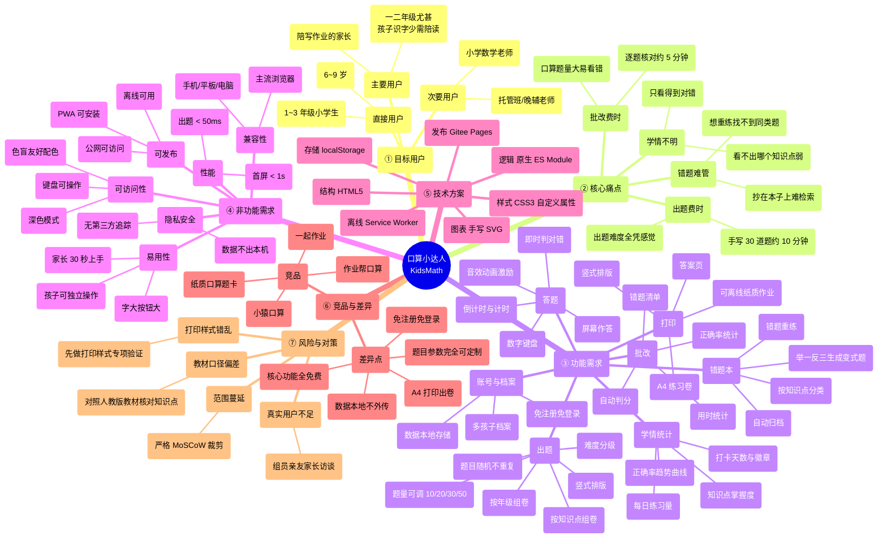
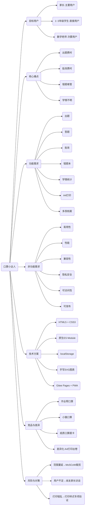
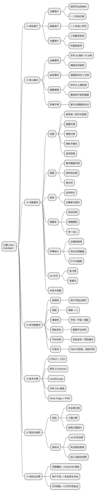

# 选题思维导图

> 对应交付物：**头脑风暴的 mindmap 图**
>
> 本文档提供两种可渲染形式，并说明在线工具绘制方法：
> 1. **Mermaid mindmap**（Gitee / GitHub 的 Markdown 渲染器可直接出图）
> 2. **PlantUML `@startmindmap`**（复制到 <https://www.plantuml.com/plantuml> 在线渲染）
> 3. 附 **ProcessOn 绘制指引**，便于导出 PNG 放入 PPT 汇报

---

## 一、选题思维导图（Mermaid 版）

### 渲染说明

若所在 Markdown 渲染器不支持 Mermaid `mindmap` 语法，可改为等价的 `graph LR` 写法：

---

## 二、选题思维导图（PlantUML 版）

复制以下内容到 <https://www.plantuml.com/plantuml/uml/> 即可在线渲染并导出 PNG/SVG：

---

## 三、ProcessOn 绘制指引（用于导出图片）

课程教案推荐使用 <https://processon.com>，步骤如下：

1. 注册登录 ProcessOn，点击「新建 → 思维导图」；
2. 选择「空白模板」，中心主题填写 **口算小达人 KidsMath**；
3. 按上文七个一级分支（目标用户 / 核心痛点 / 功能需求 / 非功能需求 / 技术方案 / 竞品与差异 / 风险与对策）逐层展开；
4. 建议配色：一级分支用 7 种区分色，二级及以下统一为深灰，避免"彩虹图"；
5. 导出 **PNG（2 倍图）** 与 **PDF** 各一份，PNG 放入 `docs/01-立项/media/mindmap.png`，PDF 用于汇报 PPT。

### 导出的图片文件清单

| 文件名 | 内容 | 用途 |
|---|---|---|
| `media/mindmap.png` | 完整选题思维导图 | 立项 Wiki 配图 |
| `media/mindmap-branch-user.png` | 目标用户 + 核心痛点分支 | 需求分析报告配图 |
| `media/mindmap-branch-func.png` | 功能需求分支 | 设计报告配图 |
