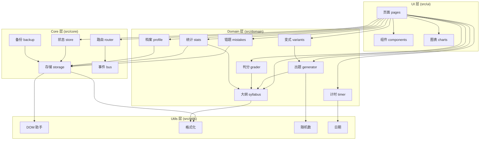

# 概要设计

> 本文档描述系统的整体架构、模块划分、接口约定与部署方案。
> 详细到函数级别的设计见 [详细设计](03-详细设计.md)。

---

## 1. 设计目标与原则

| # | 原则 | 落地方式 |
|---|---|---|
| P1 | **零依赖** | 不引入任何第三方 JS/CSS 库；全部功能自研 |
| P2 | **零构建** | 源码即产物，浏览器直接执行，无打包步骤 |
| P3 | **单向依赖** | UI → Domain → Core → Utils，禁止反向与跨层依赖 |
| P4 | **数据不外传** | 无网络请求（除首次加载静态资源），无埋点 |
| P5 | **可增量扩展** | 新增知识点仅需追加配置，不改引擎代码 |
| P6 | **打印友好** | 样式层独立于交互层，打印时只保留内容 |
| P7 | **无障碍优先** | 颜色不单独承载信息；全键盘可操作；支持深色模式 |

---

## 2. 系统架构

### 2.1 分层架构图



### 2.2 各层职责

| 层 | 职责 | 不做什么 |
|---|---|---|
| **UI 层** | 渲染界面、处理用户事件、调用 Domain 服务、页面路由 | 不含业务规则；不直接读写 localStorage |
| **Domain 层** | 承载全部业务规则：出题、判分、错题、统计 | 不操作 DOM；不关心界面长什么样 |
| **Core 层** | 提供基础设施：路由、状态、持久化、事件 | 不含业务逻辑 |
| **Utils 层** | 纯函数工具，无状态、无副作用 | 不依赖任何上层 |

### 2.3 依赖规则（强制）

| 规则 | 说明 |
|---|---|
| R1 | UI 层可依赖 Domain / Core / Utils |
| R2 | Domain 层可依赖 Core / Utils，**不可依赖 UI** |
| R3 | Core 层可依赖 Utils，**不可依赖 Domain / UI** |
| R4 | Utils 层**不依赖任何其它层** |
| R5 | Domain 层内部：`generator` 依赖 `syllabus`；`variants` 依赖 `generator`；其余模块相互独立 |

> **验证方式**：通过 `import` 语句的路径前缀静态检查（见测试用例 TC-901）。

---

## 3. 模块设计

### 3.1 模块清单

| # | 模块 | 文件 | 对外接口 | 依赖 |
|---|---|---|---|---|
| M1 | 档案服务 | `domain/profile.js` | `createProfile`, `listProfiles`, `getActiveProfile`, `switchProfile`, `updateProfile`, `removeProfile` | storage |
| M2 | 知识点大纲 | `domain/syllabus.js` | `GRADES`, `SYLLABUS`, `getKnowledgePoints`, `getKnowledgePoint`, `filterKnowledgePoints`, `getGradeDefaultKPs` | — |
| M3 | 出题引擎 | `domain/generator.js` | `generatePaper`, `generateQuestions`, `regenerateQuestion` | syllabus, utils/random |
| M4 | 判分服务 | `domain/grader.js` | `judgeAnswer`, `normalizeAnswer`, `settleSession` | syllabus |
| M5 | 错题服务 | `domain/mistakes.js` | `archiveMistake`, `listMistakes`, `markMastered`, `clearMastered`, `countMistakes` | storage, syllabus |
| M6 | 变式服务 | `domain/variants.js` | `generateVariants`, `extractFeatures` | generator |
| M7 | 统计服务 | `domain/stats.js` | `accuracyTrend`, `masteryByKP`, `practiceSummary`, `streakDays` | storage, syllabus |
| M8 | 计时服务 | `domain/timer.js` | `createTimer`, `start`, `pause`, `resume`, `stop`, `elapsed` | utils/date |
| M9 | 历史服务 | `domain/history.js` | `appendSession`, `listSessions`, `getSession`, `removeSession` | storage |
| M10 | 路由 | `core/router.js` | `register`, `navigate`, `current`, `onChange` | bus |
| M11 | 状态容器 | `core/store.js` | `getState`, `setState`, `subscribe` | storage |
| M12 | 持久化 | `core/storage.js` | `read`, `write`, `remove`, `clear`, `isAvailable` | utils/format |
| M13 | 事件总线 | `core/bus.js` | `on`, `off`, `emit` | — |
| M14 | 备份 | `core/backup.js` | `exportAll`, `importAll`, `validateBackup` | storage |

### 3.2 档案服务（M1）

**职责**：管理孩子的档案，维护"当前档案"这一全局状态。

**数据结构**

```js
/**
 * @typedef {Object} Profile
 * @property {string} id          - 唯一标识（时间戳 + 随机串）
 * @property {string} name        - 孩子昵称
 * @property {1|2|3}  grade       - 年级
 * @property {string} avatar      - 头像标识（emoji 或图标名）
 * @property {number} createdAt   - 创建时间戳
 */
```

**接口**

| 函数 | 签名 | 说明 |
|---|---|---|
| `createProfile` | `(name, grade, avatar) => Profile` | 创建档案，若为首个则自动设为当前档案 |
| `listProfiles` | `() => Profile[]` | 返回全部档案 |
| `getActiveProfile` | `() => Profile \| null` | 返回当前档案 |
| `switchProfile` | `(id) => Profile` | 切换当前档案，触发 `profile:changed` 事件 |
| `updateProfile` | `(id, patch) => Profile` | 局部更新 |
| `removeProfile` | `(id) => void` | 删除档案及其全部关联数据 |

**关键约束**
- 删除档案时，必须级联删除该档案下的 `sessions`、`mistakes`、`badges`；
- 删除当前档案后，自动切换到剩余档案中的第一个；若无剩余档案，`getActiveProfile()` 返回 `null`。

### 3.3 知识点大纲（M2）

**职责**：定义 1~3 年级全部知识点的元数据与数值约束，是出题引擎的"知识来源"。

**数据结构**

```js
/**
 * @typedef {Object} KnowledgePoint
 * @property {string}   id          - 知识点编号，如 'G1-03'
 * @property {1|2|3}    grade       - 所属年级
 * @property {string}   name        - 知识点名称
 * @property {string}   desc        - 一句话说明
 * @property {1|2|3}    difficulty  - 难度星级
 * @property {string[]} types       - 支持的题型
 * @property {Object}   constraint  - 数值范围约束
 * @property {Function} build       - 出题构造器（见详细设计）
 * @property {number}   order       - 学习顺序
 */
```

**接口**

| 函数 | 签名 | 说明 |
|---|---|---|
| `getKnowledgePoints` | `(grade?) => KnowledgePoint[]` | 按年级筛选，不传则返回全部 |
| `getKnowledgePoint` | `(id) => KnowledgePoint` | 按编号获取 |
| `filterKnowledgePoints` | `(opts) => KnowledgePoint[]` | 支持 `{grade, keyword, type, maxDifficulty}` |
| `getGradeDefaultKPs` | `(grade) => string[]` | 返回该年级的默认知识点编号列表 |

**扩展性设计**：新增一个知识点只需在 `SYLLABUS` 数组中追加一条记录并实现其 `build` 函数，
**无需修改出题引擎的任何代码**（满足 NFR-07 第 2 条）。

### 3.4 出题引擎（M3）

**职责**：依据参数生成一份题目集合。这是系统的核心模块。

**输入参数**

```js
/**
 * @typedef {Object} GenerateOptions
 * @property {string[]} kpIds       - 知识点编号列表
 * @property {number}   count       - 题量（5~100）
 * @property {'easy'|'normal'|'hard'} difficulty - 难度档位
 * @property {string[]} types       - 题型列表
 * @property {number}   [seed]      - 随机种子（用于可复现测试）
 */
```

**输出结构**

```js
/**
 * @typedef {Object} Question
 * @property {string} id          - 题目唯一标识
 * @property {string} kpId        - 所属知识点
 * @property {string} type        - 题型：'horizontal'|'vertical'|'compare'|'fill'|'chain'
 * @property {string} text        - 题干文本（用于展示）
 * @property {string} answer      - 正确答案（规范化字符串）
 * @property {number} difficulty  - 难度星级 1~3
 * @property {Object} [layout]    - 竖式题目的版式数据
 * @property {Object} params      - 生成参数（用于举一反三）
 */
```

**接口**

| 函数 | 签名 | 说明 |
|---|---|---|
| `generatePaper` | `(opts) => Paper` | 生成完整卷子 |
| `generateQuestions` | `(kpId, n, type, difficulty) => Question[]` | 单知识点批量出题 |
| `regenerateQuestion` | `(question) => Question` | 保持知识点与题型，换一道新题 |

**核心算法**：见 [数据结构与算法设计 · 出题算法](04-数据结构与算法设计.md#21-出题算法)。

### 3.5 判分服务（M4）

| 函数 | 签名 | 说明 |
|---|---|---|
| `normalizeAnswer` | `(raw) => string` | 规范化答案（去空格、统一分数线、统一小数格式） |
| `judgeAnswer` | `(question, userAnswer) => boolean` | 单题判分 |
| `settleSession` | `(paper, attempts, elapsedMs) => SessionResult` | 整卷结算，产出成绩与错题清单 |

**判分规则**
- 数值答案：按数值比较（`624` 与 `624.0` 视为相同）；
- 分数答案：统一为最简分数后比较（`2/4` 与 `1/2` 视为相同）；
- 字符串答案（比较大小）：严格匹配 `<` / `>` / `=`；
- 空答案：判定为"未作答"，不计入错误，但计入总题数。

### 3.6 错题服务（M5）

| 函数 | 签名 | 说明 |
|---|---|---|
| `archiveMistake` | `(profileId, question, userAnswer) => Mistake` | 归档错题，已存在则累加次数 |
| `listMistakes` | `(profileId, filter?) => Mistake[]` | 列出错题，支持按知识点/状态筛选 |
| `markMastered` | `(profileId, mistakeId) => void` | 标记为已攻克 |
| `clearMastered` | `(profileId) => number` | 清空已攻克错题，返回清理条数 |
| `countMistakes` | `(profileId) => {pending, mastered}` | 统计待攻克 / 已攻克数量 |

**去重规则**：按 `kpId + normalizedExpression` 判重；加乘交换律视为同题。

### 3.7 变式服务（M6）

| 函数 | 签名 | 说明 |
|---|---|---|
| `extractFeatures` | `(question) => Object` | 从错题中提取"同型特征"（知识点 + 操作数位数 + 是否进位/退位） |
| `generateVariants` | `(question, n = 3) => Question[]` | 生成 n 道同型变式题 |

**同型判定**：变式题必须与原题满足
① 知识点相同；② 题型相同；③ 操作数位数相同；④ 难度星级相同或相差 1；
⑤ 数值与原题不同；⑥ 不在原题所在卷子中出现过。

### 3.8 统计服务（M7）

| 函数 | 签名 | 说明 |
|---|---|---|
| `accuracyTrend` | `(profileId, range) => {label, value}[]` | 正确率趋势序列 |
| `masteryByKP` | `(profileId) => {kpId, name, mastery, level}[]` | 各知识点掌握度，按升序 |
| `practiceSummary` | `(profileId) => Summary` | 累计天数/题数/时长/连续打卡 |
| `streakDays` | `(profileId) => number` | 连续打卡天数 |

**掌握度口径**（依评审 P-09 的修正）：
`mastery = 该知识点下全部作答记录中答对题数 ÷ 总作答题数`，**含错题重练的记录**。

### 3.9 路由（M10）

采用**哈希路由**，避免静态托管下的 404 问题。

| 路由 | 页面 | 参数 |
|---|---|---|
| `#/home` | 出题台 | — |
| `#/syllabus` | 知识点选择 | `?grade=3` |
| `#/paper` | 组卷预览 | — |
| `#/quiz` | 在线答题 | — |
| `#/result` | 成绩结算 | `?sid=<sessionId>` |
| `#/mistakes` | 错题本 | `?kp=G3-01` |
| `#/variants` | 举一反三 | `?mid=<mistakeId>` |
| `#/stats` | 学情统计 | — |
| `#/history` | 练习历史 | — |
| `#/profiles` | 档案管理 | — |
| `#/settings` | 设置与数据 | — |
| `#/print` | 打印预览 | `?sid=<sessionId>` |

**未匹配路由**：回退到 `#/home`。

### 3.10 持久化（M12）

**存储键设计**

| 键 | 内容 | 大小估算 |
|---|---|---|
| `km:meta` | 版本号、创建时间、最后访问时间 | < 200 B |
| `km:profiles` | 档案列表 | < 1 KB |
| `km:activeProfileId` | 当前档案 ID | < 50 B |
| `km:data:<profileId>` | 该档案的 sessions / mistakes / badges | 每档案约 200 KB ~ 2 MB |
| `km:settings` | 用户偏好（音效、深色模式、倒计时默认值） | < 500 B |

**分档案存储的理由**：避免单个键过大；切换档案时只需读取对应键；删除档案时只需删除对应键（天然级联）。

**版本迁移**：`km:meta.version` 记录数据结构版本；读取时若版本低于当前版本，执行迁移函数链。

---

## 4. 接口设计

### 4.1 内部事件（事件总线）

| 事件名 | 触发时机 | 载荷 | 订阅方 |
|---|---|---|---|
| `profile:changed` | 切换档案 | `{profileId}` | 各页面、统计服务 |
| `paper:generated` | 组卷完成 | `{paper}` | 预览页 |
| `quiz:started` | 开始答题 | `{paper}` | 计时器、答题页 |
| `quiz:answered` | 单题作答 | `{questionId, correct}` | 答题页、激励反馈 |
| `quiz:finished` | 练习结束 | `{result}` | 结算页、历史服务、错题服务 |
| `mistake:mastered` | 错题攻克 | `{mistakeId}` | 错题本页 |
| `data:changed` | 数据写入 | `{keys}` | 统计页（触发重算） |
| `storage:error` | 存储失败 | `{reason}` | 全局提示 |

### 4.2 外部接口

本系统**无服务端接口**。对外仅暴露：

| 接口 | 说明 |
|---|---|
| 静态资源 | `index.html`、CSS、JS、图标、manifest、sw.js |
| 数据导出文件 | JSON 格式备份文件（本地下载） |

**备份文件格式**

```json
{
  "format": "kidsmath-backup",
  "version": "1.0",
  "exportedAt": "2026-09-27T10:00:00.000Z",
  "profiles": [ { "id": "...", "name": "小明", "grade": 3, "avatar": "🦊", "createdAt": 0 } ],
  "data": {
    "<profileId>": {
      "sessions": [ /* 练习记录 */ ],
      "mistakes": [ /* 错题 */ ],
      "badges": [ /* 徽章 */ ]
    }
  },
  "settings": { "sound": false, "theme": "auto" }
}
```

---

## 5. 数据结构总览

| 实体 | 存储位置 | 关键字段 | 详见 |
|---|---|---|---|
| Profile | `km:profiles` | id, name, grade, avatar | 3.2 |
| KnowledgePoint | 内存（代码常量） | id, grade, name, constraint, build | 3.3 |
| Question | 内存（运行时） | id, kpId, type, text, answer, params | 3.4 |
| Paper | 内存 → Session | id, questions[], options, createdAt | 3.4 |
| Session | `km:data:<pid>.sessions` | id, paperId, attempts[], correct, total, elapsedMs, finishedAt | 3.5 |
| Mistake | `km:data:<pid>.mistakes` | id, kpId, text, answer, userAnswer, wrongCount, mastered, firstWrongAt | 3.6 |
| Badge | `km:data:<pid>.badges` | id, name, earnedAt | 3.8 |

完整字段定义见 [数据结构与算法设计](04-数据结构与算法设计.md)。

---

## 6. 部署设计

### 6.1 部署形态

**纯静态部署**：全部文件（HTML / CSS / JS / 图标 / manifest）上传至静态托管服务，
浏览器直接加载运行，无服务端进程。

```
用户浏览器  ──HTTPS──►  静态托管服务（Gitee Pages）
                              │
                              └── 返回 index.html / css / js / icons
                              │
                        用户浏览器本地执行全部逻辑
                              │
                              └── 数据写入 localStorage（不出本机）
```

### 6.2 目录结构

```
儿童学习/
├── index.html                    # 唯一入口页
├── manifest.webmanifest          # PWA 清单
├── sw.js                         # Service Worker（离线缓存）
├── favicon.ico
├── assets/
│   ├── css/
│   │   ├── tokens.css            # 设计令牌（颜色/间距/字号/圆角）
│   │   ├── base.css              # 重置与基础排版
│   │   ├── components.css        # 组件样式
│   │   ├── pages.css             # 页面样式
│   │   └── print.css             # 打印样式（@media print）
│   └── icons/                    # PWA 图标与界面图标
├── src/
│   ├── main.js                   # 应用入口
│   ├── core/
│   │   ├── bus.js
│   │   ├── router.js
│   │   ├── storage.js
│   │   ├── store.js
│   │   └── backup.js
│   ├── domain/
│   │   ├── syllabus.js           # 24 个知识点定义（含出题构造器）
│   │   ├── generator.js
│   │   ├── grader.js
│   │   ├── mistakes.js
│   │   ├── variants.js
│   │   ├── stats.js
│   │   ├── timer.js
│   │   ├── history.js
│   │   └── profile.js
│   ├── ui/
│   │   ├── shell.js              # 布局外壳（顶栏 / 侧栏 / 内容区）
│   │   ├── pages/
│   │   │   ├── home.js
│   │   │   ├── syllabus.js
│   │   │   ├── paper.js
│   │   │   ├── quiz.js
│   │   │   ├── result.js
│   │   │   ├── mistakes.js
│   │   │   ├── variants.js
│   │   │   ├── stats.js
│   │   │   ├── history.js
│   │   │   ├── profiles.js
│   │   │   ├── settings.js
│   │   │   └── print.js
│   │   ├── components/
│   │   │   ├── keypad.js         # 数字键盘
│   │   │   ├── question.js       # 题目渲染（含竖式）
│   │   │   ├── toast.js          # 轻提示
│   │   │   ├── modal.js          # 模态框
│   │   │   ├── feedback.js       # 答题反馈动效
│   │   │   └── profile-switcher.js
│   │   └── charts/
│   │       ├── line.js           # 折线图（正确率趋势）
│   │       ├── bar.js            # 条形图（知识点掌握度）
│   │       └── heatmap.js        # 热力格（打卡日历）
│   └── utils/
│       ├── dom.js
│       ├── format.js
│       ├── random.js
│       └── date.js
└── docs/                         # 过程文档
```

### 6.3 发布流程

| 步骤 | 操作 |
|---|---|
| 1 | 本地开发完成，通过全部测试用例 |
| 2 | 推送代码至 Gitee 仓库 |
| 3 | 在仓库「服务 → Gitee Pages」中开启 Pages 服务，选择部署分支 |
| 4 | 等待构建完成，获得公网地址 `https://<用户名>.gitee.io/<仓库名>/` |
| 5 | 验证公网访问、PWA 安装、打印功能 |
| 6 | 生成二维码，用于推广与课程汇报 |

### 6.4 部署环境要求

| 项 | 要求 |
|---|---|
| 协议 | HTTPS（Gitee Pages 默认提供；Service Worker 必需） |
| 路径 | 支持子路径部署（所有资源引用使用相对路径） |
| 缓存 | Service Worker 缓存全部静态资源，实现离线可用 |
| 兼容 | 无需服务端重写规则（哈希路由） |

---

## 7. 设计决策记录（ADR）

### ADR-01：为什么选择纯前端而非前后端分离？

| 项目 | 内容 |
|---|---|
| **状态** | ✅ 已采纳 |
| **背景** | 需要决定数据存储位置与是否有服务端 |
| **决策** | 纯前端 + localStorage |
| **理由** | ① 家长 B 明确要求数据不上传服务器；② 免注册是核心体验优势；③ 零服务端 = 零成本 + 零运维 + 无宕机；④ 静态托管即可满足课程"公网可访问"要求 |
| **代价** | 无多端同步；数据有丢失风险（用导出/导入缓解） |
| **替代方案** | Flask + SQLite（被否：需服务器，与隐私诉求冲突） |

### ADR-02：为什么用生成式出题而非预置题库？

| 项目 | 内容 |
|---|---|
| **状态** | ✅ 已采纳 |
| **背景** | 需要决定题目从哪来 |
| **决策** | 为每个知识点实现参数化生成器 |
| **理由** | ① 题库有限，孩子做久了会记住答案；② 生成式可无限出题，题量不受限；③ **举一反三天然可复用生成器**（只需换参数）；④ 数据体积小，不占用 localStorage |
| **代价** | 需为 24 个知识点各写一个构造器；生成逻辑需严格测试以防出错题 |
| **替代方案** | 预置题库（被否：题量受限、无法举一反三、占用存储） |

### ADR-03：为什么用哈希路由而非 History API？

| 项目 | 内容 |
|---|---|
| **状态** | ✅ 已采纳 |
| **背景** | SPA 需要路由 |
| **决策** | `#/page` 哈希路由 |
| **理由** | 静态托管下 History API 需要服务端配置 fallback 重写规则，Gitee Pages 不支持；哈希路由刷新页面不会 404 |
| **代价** | URL 不够美观；SEO 不友好（本项目无需 SEO） |

### ADR-04：为什么手写 SVG 图表而非引入图表库？

| 项目 | 内容 |
|---|---|
| **状态** | ✅ 已采纳 |
| **背景** | 统计页需要折线图、条形图、热力格 |
| **决策** | 手写 SVG 渲染 |
| **理由** | ① 零依赖原则；② 图表库体积大（ECharts 约 1MB），与 NFR-01 的体积预算冲突；③ 手写可完全控制配色，满足色盲友好的无障碍要求；④ 本项目的图表类型简单（折线、条形、热力格） |
| **代价** | 需自行处理坐标轴、刻度、标签防重叠（约 300~400 行代码） |

### ADR-05：为什么按档案分键存储而非单一大对象？

| 项目 | 内容 |
|---|---|
| **状态** | ✅ 已采纳 |
| **背景** | 多档案的数据如何组织 |
| **决策** | `km:data:<profileId>` 分键存储 |
| **理由** | ① 避免单键体积过大导致读写变慢；② 切换档案只需读一个键；③ 删除档案只需删一个键，天然级联；④ 单档案损坏不影响其它档案 |
| **代价** | 全局统计（跨档案）需要遍历多个键（本项目无此需求） |

---

## 8. 需求覆盖检查

| 模块 | 覆盖需求 | 覆盖率 |
|---|---|---|
| M1 档案服务 | FR-01, FR-02, FR-03 | 3/3 |
| M2 知识点大纲 | FR-04, FR-05, FR-06 | 3/3 |
| M3 出题引擎 | FR-07, FR-08, FR-09, FR-10, FR-11 | 5/5 |
| M4 判分服务 | FR-13, FR-16 | 2/2 |
| M5 错题服务 | FR-18, FR-19, FR-21 | 3/3 |
| M6 变式服务 | FR-20 | 1/1 |
| M7 统计服务 | FR-22, FR-23, FR-24 | 3/3 |
| M8 计时服务 | FR-14 | 1/1 |
| M9 历史服务 | FR-17 | 1/1 |
| M12 持久化 | FR-27 | 1/1 |
| M14 备份 | FR-28 | 1/1 |
| UI 打印样式 | FR-25, FR-26 | 2/2 |
| UI 答题页 | FR-12, FR-15 | 2/2 |
| **合计** | **28 条功能需求** | **28/28 = 100%** |
