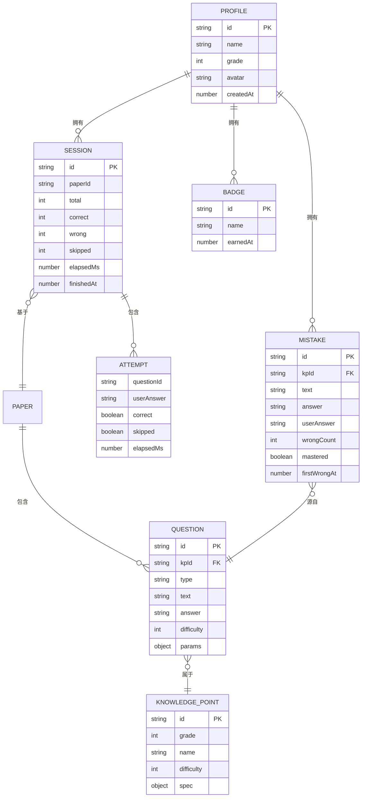

# 数据结构与算法设计

> **历史材料提示（2026-10-25）**：本文保留原始阶段记录，不作为最新范围清单。现行 SRS V1.4 已撤销打印相关 FR-21/25/26；此前打印诉求/评审/验证描述仅供追溯，不再列入开发或验收。详见 [变更说明](../06-过程管理/01-取消打印功能变更说明.md)。

> 本文档描述系统的核心数据模型与关键算法，是编码实现的直接依据。

---

## 1. 数据模型

### 1.1 实体关系



### 1.2 存储结构

#### localStorage 键值设计

| 键 | 类型 | 说明 |
|---|---|---|
| `km:meta` | `Meta` | `{version, createdAt, lastVisitAt}` |
| `km:profiles` | `Profile[]` | 全部档案 |
| `km:active` | `string` | 当前档案 ID |
| `km:data:<pid>` | `ProfileData` | 该档案的全部业务数据 |
| `km:settings` | `Settings` | 用户偏好 |

```js
/**
 * @typedef {Object} ProfileData
 * @property {Session[]}  sessions  - 练习记录（时间倒序）
 * @property {Mistake[]}  mistakes  - 错题
 * @property {Badge[]}    badges    - 徽章
 */
```

#### 存储容量估算

| 数据 | 单条大小 | 数量 | 小计 |
|---|---|---|---|
| Session（含 30 条 attempt） | ≈ 3 KB | 1000 | 3 MB |
| Mistake | ≈ 200 B | 500 | 100 KB |
| Profile | ≈ 150 B | 3 | 450 B |
| **合计（单档案）** | | | **≈ 3.1 MB** |

> ⚠️ localStorage 上限约 5 MB。因此对 `sessions` 实施**滚动淘汰**：
> 单档案保留最近 **500** 条完整记录；更早的记录压缩为"摘要记录"
> （仅保留日期、题量、正确率、用时，不含逐题明细），摘要记录最多保留 2000 条。

---

## 2. 核心算法

### 2.1 出题算法

#### 2.1.1 设计思路：配置驱动的生成器

**问题**：24 个知识点若各写一套生成逻辑，代码重复严重，且新增知识点需改动引擎。

**方案**：把每个知识点抽象为一份 **`spec`（数值约束规格）**，由**统一的生成器**消费：

```
知识点 spec  ──┐
               ├──►  generateFromSpec(spec, rng)  ──►  Question
随机数发生器 ──┘
```

**收益**：新增知识点 = 追加一条配置，**零代码改动**（满足 NFR-07 第 2 条）。

#### 2.1.2 规格（spec）结构

```js
/**
 * @typedef {Object} Spec
 * @property {'add'|'sub'|'mul'|'div'|'mix'|'compare'} op  - 运算类型
 * @property {'int'|'fraction'|'decimal'} kind             - 数值种类
 * @property {Range}  [a]         - 第一个操作数范围
 * @property {Range}  [b]         - 第二个操作数范围
 * @property {Range}  [result]    - 结果范围约束
 * @property {boolean}[carry]     - 是否强制进位（加法）/ 退位（减法）
 * @property {boolean}[remainder] - 除法是否允许余数
 * @property {number} [denom]     - 分数分母范围（同分母）
 * @property {number} [scale]     - 小数位数（1 表示一位小数）
 * @property {number} [terms]     - 混合运算的项数
 * @property {boolean}[paren]     - 混合运算是否含括号
 */

/** @typedef {{min:number, max:number}} Range */
```

#### 2.1.3 各知识点的 spec 配置

| 编号 | 知识点 | op | 关键约束 |
|---|---|---|---|
| G1-01 | 10 以内加法 | add | `a∈[1,9], b∈[1,9], result≤10` |
| G1-02 | 10 以内减法 | sub | `a∈[2,10], b∈[1,a], result≥0` |
| G1-03 | 20 以内进位加法 | add | `a∈[2,9], b∈[2,9], result∈[11,20]`（隐含进位） |
| G1-04 | 20 以内退位减法 | sub | `a∈[11,18], b∈[2,9], result∈[1,9]`（隐含退位） |
| G1-05 | 100 以内整十数加减 | add/sub | `a,b 均为 10 的倍数, result≤100` |
| G1-06 | 两位数加减一位数（不进位/退位） | add/sub | `a∈[10,99], b∈[1,9], 个位不进位/不退位` |
| G1-07 | 两位数加减整十数 | add/sub | `a∈[10,99], b∈{10,20,…,90}, result≤100` |
| G1-08 | 100 以内数的认识与比较 | compare | `a,b∈[1,100]` |
| G2-01 | 两位数加法（进位） | add | `a,b∈[10,99], result≤100, carry=true` |
| G2-02 | 两位数减法（退位） | sub | `a∈[11,99], b∈[10,99], a>b, borrow=true` |
| G2-03 | 表内乘法 | mul | `a,b∈[2,9]` |
| G2-04 | 表内除法 | div | `a,b∈[2,9], dividend=a*b, 无余数` |
| G2-05 | 乘加乘减混合 | mix | `a×b±c`，`a,b∈[2,9], c∈[1,20]` |
| G2-06 | 万以内数的认识与比较 | compare | `a,b∈[100,9999]` |
| G2-07 | 整百整千数加减 | add/sub | `a,b 为 100 的倍数, result≤9999` |
| G2-08 | 100 以内加减混合 | mix | `a±b±c`，中间结果非负 |
| G3-01 | 多位数乘一位数 | mul | `a∈[100,999], b∈[2,9]` |
| G3-02 | 两位数乘两位数 | mul | `a,b∈[10,99]` |
| G3-03 | 除数是一位数的除法 | div | `b∈[2,9], 商∈[10,99], 无余数` |
| G3-04 | 商中间或末尾有 0 的除法 | div | `b∈[2,9], 商∈[100,999] 且商的十进制表示含 0` |
| G3-05 | 两位数除以一位数（有余数） | div | `a∈[10,99], b∈[2,9], remainder=true` |
| G3-06 | 两步混合运算（含括号） | mix | 三数混合，含括号，中间结果非负 |
| G3-07 | 同分母分数加减 | add/sub | `kind=fraction, denom∈[2,10], 结果最简` |
| G3-08 | 一位小数加减 | add/sub | `kind=decimal, scale=1, result≤100` |

#### 2.1.4 生成主流程

```
FUNCTION generateQuestions(kpId, count, difficulty, types, seed):
    kp   ← SYLLABUS[kpId]
    rng  ← createRandom(seed)          # 可复现的伪随机
    seen ← Set()                        # 去重集合
    out  ← []

    WHILE out.length < count:
        spec ← adjustSpec(kp.spec, difficulty)   # 按难度档位收窄/放宽范围
        q    ← generateFromSpec(spec, rng)       # 生成一道题
        IF q IS NULL: CONTINUE                   # 约束矛盾，重试
        key  ← dedupeKey(q)                      # 去重键
        IF seen.has(key): CONTINUE               # 已存在，重试
        seen.add(key)

        type ← pickType(types, kp.types, rng)    # 选择题型
        q.type       ← type
        q.text       ← renderText(q, type)       # 渲染题干
        q.difficulty ← q.difficulty
        q.id         ← makeId(kpId, out.length)
        out.push(q)

    RETURN out
```

**终止性保证**：每个 spec 的可生成空间远大于请求题量
（最小空间为 G1-03 的 20 以内进位加法，共 36 种组合，而单次题量上限 100 时
会触发"放宽约束"分支：当连续重试 200 次仍无法产出新题时，允许生成
"同知识点但题型不同"的题目，或提示用户减少题量）。

```
FUNCTION generateFromSpec(spec, rng):
    SWITCH spec.op:
        CASE 'add':      RETURN genAdd(spec, rng)
        CASE 'sub':      RETURN genSub(spec, rng)
        CASE 'mul':      RETURN genMul(spec, rng)
        CASE 'div':      RETURN genDiv(spec, rng)
        CASE 'mix':      RETURN genMix(spec, rng)
        CASE 'compare':  RETURN genCompare(spec, rng)
```

#### 2.1.5 各运算生成器（伪代码）

```
FUNCTION genAdd(spec, rng):
    FOR attempt IN 1..100:
        a ← rng.int(spec.a.min, spec.a.max)
        b ← rng.int(spec.b.min, spec.b.max)
        IF spec.carry AND (a % 10 + b % 10) < 10: CONTINUE   # 要求进位
        IF NOT spec.carry AND (a % 10 + b % 10) >= 10: CONTINUE
        r ← a + b
        IF r > spec.result.max OR r < spec.result.min: CONTINUE
        RETURN { op:'add', a, b, answer: str(r),
                 params:{op:'add', a, b, digits:digits(max(a,b)),
                         carry:(a%10 + b%10) >= 10} }
    RETURN NULL
```

```
FUNCTION genSub(spec, rng):
    FOR attempt IN 1..100:
        a ← rng.int(spec.a.min, spec.a.max)
        b ← rng.int(spec.b.min, spec.b.max)
        IF a < b: CONTINUE                      # 小学阶段不出现负数
        IF spec.borrow AND (a % 10) >= (b % 10): CONTINUE   # 要求退位
        IF NOT spec.borrow AND (a % 10) < (b % 10): CONTINUE
        r ← a - b
        IF r < spec.result.min OR r > spec.result.max: CONTINUE
        RETURN { op:'sub', a, b, answer: str(r),
                 params:{op:'sub', a, b, digits:digits(a),
                         borrow:(a%10) < (b%10)} }
    RETURN NULL
```

```
FUNCTION genMul(spec, rng):
    a ← rng.int(spec.a.min, spec.a.max)
    b ← rng.int(spec.b.min, spec.b.max)
    r ← a * b
    RETURN { op:'mul', a, b, answer: str(r),
             params:{op:'mul', a, b, digits:digits(max(a,b))} }
```

```
FUNCTION genDiv(spec, rng):
    FOR attempt IN 1..100:
        b ← rng.int(spec.b.min, spec.b.max)          # 除数
        q ← rng.int(spec.quotient.min, spec.quotient.max)  # 商
        IF spec.quotientHasZero AND NOT hasZeroDigit(q): CONTINUE
        IF NOT spec.quotientHasZero AND hasZeroDigit(q) AND spec.strictZero: CONTINUE
        dividend ← b * q
        IF spec.remainder:
            rem ← rng.int(1, b-1)
            dividend ← dividend + rem
        IF dividend > spec.dividend.max: CONTINUE
        answer ← spec.remainder ? (q + '余' + rem) : str(q)
        RETURN { op:'div', a:dividend, b, answer,
                 params:{op:'div', a:dividend, b, quotient:q,
                         rem: spec.remainder ? rem : 0, digits:digits(q)} }
    RETURN NULL
```

```
FUNCTION genMix(spec, rng):
    # 生成 a ⊕ b ⊗ c 形式的混合运算，保证中间结果非负
    FOR attempt IN 1..200:
        a ← rng.int(spec.a.min, spec.a.max)
        b ← rng.int(spec.b.min, spec.b.max)
        c ← rng.int(spec.c.min, spec.c.max)
        expr ← spec.pattern             # 如 ['+','-'] 或 ['×','+']
        IF spec.paren:
            # 含括号：先算括号内
            inner ← applyOp(expr[0], a, b)
            IF inner < 0: CONTINUE
            r ← applyOp(expr[1], inner, c)
        ELSE:
            # 无括号：按运算优先级
            r ← evalByPrecedence(a, expr[0], b, expr[1], c)
        IF r < 0 OR r > spec.result.max: CONTINUE
        RETURN { op:'mix', answer:str(r),
                 params:{op:'mix', a, b, c, pattern:expr,
                         paren:spec.paren, answer:r} }
    RETURN NULL
```

```
FUNCTION genCompare(spec, rng):
    a ← rng.int(spec.a.min, spec.a.max)
    b ← rng.int(spec.b.min, spec.b.max)
    IF a == b AND NOT spec.allowEqual: b ← b + 1
    answer ← a > b ? '>' : (a < b ? '<' : '=')
    RETURN { op:'compare', a, b, answer,
             params:{op:'compare', a, b, digits:digits(max(a,b))} }
```

**分数与小数**：

```
FUNCTION genFractionAdd(spec, rng):
    d ← rng.int(spec.denom.min, spec.denom.max)      # 同分母
    n1 ← rng.int(1, d-1); n2 ← rng.int(1, d-1)
    IF spec.op == 'sub' AND n1 < n2: SWAP(n1, n2)
    n ← spec.op == 'add' ? n1+n2 : n1-n2
    IF n == 0: CONTINUE                               # 避免结果为 0
    (n, d2) ← simplify(n, d)                          # 约分
    answer ← n + '/' + d2
    RETURN { kind:'fraction', answer, params:{...} }
```

```
FUNCTION genDecimalAdd(spec, rng):
    # 用整数运算避免浮点误差：全部放大 10^scale 倍
    s ← 10 ** spec.scale                             # scale=1 → s=10
    a ← rng.int(spec.a.min*s, spec.a.max*s)
    b ← rng.int(spec.b.min*s, spec.b.max*s)
    r ← spec.op == 'add' ? a+b : a-b
    IF r < 0: CONTINUE
    answer ← formatScaled(r, s)                       # 如 35 → '3.5'
    RETURN { kind:'decimal', answer, params:{...} }
```

> **关键设计**：小数运算全部转为**整数运算**（放大 10^scale 倍），
> 从根本上避免 IEEE 754 浮点误差（如 `0.1 + 0.2 = 0.30000000000000004`）。
> 这是保证"答案 100% 正确"（NFR-03）的关键手段。

#### 2.1.6 难度调整

```
FUNCTION adjustSpec(spec, difficulty):
    # difficulty: 'easy' | 'normal' | 'hard'
    ratio ← { easy: 0.6, normal: 1.0, hard: 1.0 }[difficulty]
    adjusted ← clone(spec)

    IF difficulty == 'easy':
        # 收窄取值范围：从区间下部取 60%
        FOR each range R IN [a, b, result]:
            IF R EXISTS:
                R.max ← ceil(R.min + (R.max - R.min) * 0.6)
        adjusted.carry ← false        # 简单档不出进位题
        adjusted.borrow ← false

    IF difficulty == 'hard':
        # 放宽上界至 110%，并强制进位/退位
        FOR each range R IN [a, b, result]:
            IF R EXISTS: R.max ← ceil(R.max * 1.1)
        IF spec.carry  IS DEFINED: adjusted.carry  ← true
        IF spec.borrow IS DEFINED: adjusted.borrow ← true

    RETURN adjusted
```

#### 2.1.7 去重键设计

```
FUNCTION dedupeKey(q):
    IF q.op IN ['add', 'mul']:
        # 加法、乘法满足交换律，交换操作数视为同一题
        RETURN q.kpId + ':' + q.op + ':' + min(q.a,q.b) + ',' + max(q.a,q.b)
    ELSE:
        RETURN q.kpId + ':' + q.op + ':' + q.a + ',' + q.b
```

> 该规则与需求评审问题 **P-10** 的结论一致：`37+25` 与 `25+37` 视为同一道题。

#### 2.1.8 复杂度分析

| 指标 | 复杂度 | 说明 |
|---|---|---|
| 单题生成 | `O(1)` 期望 | 约束命中率高；最坏 100 次重试后返回 NULL |
| 整卷生成（n 题） | `O(n)` 期望 | 去重集合为哈希表，查找 `O(1)` |
| 空间 | `O(n)` | 仅存题目对象 |
| 实测性能 | **< 5ms / 30 题** | 远优于 NFR-01 要求的 50ms |

---

### 2.2 举一反三算法

**目标**：由一道错题，生成 3 道**同型但不同值**的新题。

#### 2.2.1 特征提取

```
FUNCTION extractFeatures(question):
    p ← question.params
    RETURN {
        kpId:     question.kpId,
        op:       p.op,                        # 运算类型
        digits:   p.digits,                    # 最大操作数位数
        carry:    p.carry  ?? null,            # 是否进位
        borrow:   p.borrow ?? null,            # 是否退位
        rem:      p.rem    ?? 0,               # 是否带余数
        pattern:  p.pattern ?? null,           # 混合运算的运算符模式
        paren:    p.paren  ?? false,
        kind:     question.kind ?? 'int',      # 数值种类
        difficulty: question.difficulty
    }
```

#### 2.2.2 变式生成

```
FUNCTION generateVariants(question, n = 3, exclude = Set()):
    f  ← extractFeatures(question)
    kp ← SYLLABUS[f.kpId]
    rng ← createRandom()

    # 1. 在原 spec 基础上，构造"同型约束"
    variantSpec ← clone(kp.spec)
    variantSpec.carry  ← f.carry
    variantSpec.borrow ← f.borrow
    variantSpec.remainder ← f.rem > 0
    variantSpec.pattern ← f.pattern
    variantSpec.paren  ← f.paren

    # 2. 按位数对齐取值范围（保证"同型"）
    FOR each range R IN [a, b, quotient]:
        IF R EXISTS AND f.digits IS NOT NULL:
            lo ← 10 ** (f.digits - 1)
            hi ← 10 ** f.digits - 1
            R.min ← max(R.min, lo)
            R.max ← min(R.max, hi)

    # 3. 生成，排除原题与已出现过的题
    exclude ← exclude ∪ { dedupeKey(question) }
    out ← []
    guard ← 0
    WHILE out.length < n AND guard < 300:
        guard ← guard + 1
        v ← generateFromSpec(variantSpec, rng)
        IF v IS NULL: CONTINUE
        k ← dedupeKey(v)
        IF exclude.has(k): CONTINUE
        exclude.add(k)
        v.kpId ← f.kpId
        v.type ← question.type              # 题型保持一致
        v.text ← renderText(v, v.type)
        v.difficulty ← f.difficulty
        v.id ← makeId(f.kpId, 'v' + out.length)
        out.push(v)

    RETURN out
```

#### 2.2.3 同型性保证（对应 FR-20 的验收标准）

| 验收标准 | 算法保证方式 |
|---|---|
| 同知识点 | `variantSpec` 来自 `kp.spec`，`kpId` 直接继承 |
| 同题型 | `v.type ← question.type` 强制赋值 |
| 数值不同 | `exclude` 集合排除原题去重键 |
| 难度相同或相近 | 位数对齐 + 强制相同的 carry/borrow/remainder 特征 |
| 不在原卷出现 | 调用方传入 `exclude = 原卷全部去重键` |

---

### 2.3 判分算法

```
FUNCTION normalizeAnswer(raw, kind):
    s ← trim(raw)
    IF s == '': RETURN ''

    SWITCH kind:
        CASE 'int':
            # 允许前导零："007" → "7"
            RETURN str(parseInt(s, 10))
        CASE 'decimal':
            # 统一为去掉尾随零的形式："3.50" → "3.5"，"3.0" → "3"
            RETURN trimTrailingZeros(s)
        CASE 'fraction':
            # 统一为最简分数："2/4" → "1/2"
            (n, d) ← parseFraction(s)
            (n, d) ← simplify(n, d)
            RETURN d == 1 ? str(n) : n + '/' + d
        CASE 'sign':
            # 比较大小：只接受 < > =
            RETURN s IN ['<','>','='] ? s : ''
```

```
FUNCTION judgeAnswer(question, rawAnswer):
    ua ← normalizeAnswer(rawAnswer, question.kind ?? 'int')
    ca ← normalizeAnswer(question.answer, question.kind ?? 'int')
    IF ua == '': RETURN { correct:false, skipped:true }
    RETURN { correct: ua == ca, skipped:false }
```

```
FUNCTION settleSession(paper, attempts, elapsedMs):
    total ← paper.questions.length
    correct ← 0; wrong ← 0; skipped ← 0
    wrongList ← []

    FOR each q IN paper.questions:
        at ← attempts[q.id]
        IF at IS NULL OR at.skipped:
            skipped ← skipped + 1
        ELSE IF at.correct:
            correct ← correct + 1
        ELSE:
            wrong ← wrong + 1
            wrongList.push({ question:q, userAnswer:at.userAnswer })

    accuracy ← total == 0 ? 0 : round(correct / total * 1000) / 10   # 一位小数
    grade    ← accuracy >= 95 ? '优秀'
             : accuracy >= 80 ? '良好'
             : '加油'

    RETURN { total, correct, wrong, skipped, accuracy, grade,
             elapsedMs, avgMs: total == 0 ? 0 : round(elapsedMs / total),
             wrongList, finishedAt: Date.now() }
```

> 正确率分级边界（95% / 80%）与需求评审问题 **P-07** 的结论一致。

---

### 2.4 错题去重与归档

```
FUNCTION archiveMistake(profileId, question, userAnswer):
    key      ← dedupeKey(question)
    mistakes ← readMistakes(profileId)
    existing ← mistakes.find(m => m.key == key)

    IF existing IS NOT NULL:
        existing.wrongCount ← existing.wrongCount + 1
        existing.userAnswer ← userAnswer          # 更新为最近一次的错误答案
        existing.mastered   ← false               # 再次答错 → 重新变为待攻克
        existing.lastWrongAt ← Date.now()
    ELSE:
        mistakes.push({
            id: makeId('m'),
            key,                                   # 去重键（持久化）
            kpId: question.kpId,
            type: question.type,
            text: question.text,
            answer: question.answer,
            userAnswer,
            params: question.params,               # 举一反三需要
            kind: question.kind ?? 'int',
            wrongCount: 1,
            mastered: false,
            firstWrongAt: Date.now(),
            lastWrongAt: Date.now()
        })

    writeMistakes(profileId, mistakes)
    RETURN existing ?? last(mistakes)
```

---

### 2.5 统计算法

#### 2.5.1 正确率趋势

```
FUNCTION accuracyTrend(profileId, range):
    sessions ← readSessions(profileId)            # 已按时间倒序
    IF range != 'all': sessions ← sessions.slice(0, range)
    sessions ← reverse(sessions)                  # 转为时间正序，供绘图
    RETURN sessions.map(s => ({
        label: formatDate(s.finishedAt, 'M/D'),
        value: s.accuracy
    }))
```

#### 2.5.2 知识点掌握度

```
FUNCTION masteryByKP(profileId):
    sessions ← readSessions(profileId)
    acc ← Map()      # kpId → { correct, total }

    FOR each s IN sessions:
        FOR each q IN s.paper.questions:
            at ← s.attempts[q.id]
            IF at IS NULL OR at.skipped: CONTINUE     # 跳过不计入
            e ← acc.get(q.kpId) ?? { correct:0, total:0 }
            e.total ← e.total + 1
            IF at.correct: e.correct ← e.correct + 1
            acc.set(q.kpId, e)

    result ← []
    FOR [kpId, e] OF acc:
        mastery ← e.total == 0 ? 0 : round(e.correct / e.total * 100)
        level   ← mastery >= 85 ? 'good'
                : mastery >= 60 ? 'warn'
                : 'weak'
        result.push({ kpId, name: SYLLABUS[kpId].name, mastery, level,
                      total: e.total })
    result.sort((x, y) => x.mastery - y.mastery)      # 薄弱在前
    RETURN result
```

> 掌握度阈值（85% / 60%）与 FR-23 验收标准一致；
> 跳过题不计入分母，避免"跳过"被误判为"不会"。

#### 2.5.3 连续打卡天数

```
FUNCTION streakDays(profileId):
    days ← uniqueDays(readSessions(profileId))    # 转为 'YYYY-MM-DD' 集合，降序
    IF days IS EMPTY: RETURN 0

    today ← todayStr()
    yesterday ← dateStr(Date.now() - 86400000)

    # 若今天和昨天都没练，连续天数中断
    IF days[0] != today AND days[0] != yesterday: RETURN 0

    streak ← 1
    FOR i IN 1..days.length-1:
        IF days[i-1] - days[i] == 1 day:
            streak ← streak + 1
        ELSE:
            BREAK
    RETURN streak
```

---

### 2.6 打印分栏算法

**目标**：把 n 道题排布到 A4 纸上，尽量填满一页且不跨页截断。

```
FUNCTION layoutForPrint(questions):
    n ← questions.length

    # 1. 依题量确定列数（A4 纵向，左右各留 15mm 页边距）
    cols ← n <= 12 ? 2
         : n <= 30 ? 3
         : n <= 60 ? 4
         : 5

    # 2. 依题型确定单行高度
    hasVertical ← questions.some(q => q.type == 'vertical')
    rowHeight   ← hasVertical ? 28 : 14        # mm

    # 3. 计算行数
    rows ← ceil(n / cols)

    # 4. 检查是否超出一页（A4 高 297mm - 上下页边距 30mm - 标题区 25mm）
    available ← 242                             # mm
    IF rows * rowHeight > available:
        # 竖式题改为每页更少列，或分页
        rowsPerPage ← floor(available / rowHeight)
        perPage     ← rowsPerPage * cols
        pages       ← ceil(n / perPage)
    ELSE:
        pages ← 1

    RETURN { cols, rowHeight, rows, pages, available }
```

**打印样式要点**

| 要点 | 实现 |
|---|---|
| 页面尺寸 | `@page { size: A4 portrait; margin: 15mm; }` |
| 分栏 | CSS Grid：`grid-template-columns: repeat(var(--cols), 1fr)` |
| 防截断 | 每行设 `break-inside: avoid;` |
| 隐藏交互元素 | `@media print { .no-print { display: none !important; } }` |
| 强制浅色 | `@media print { :root { --surface-1: #fff; --text-primary: #000; } }` |
| 答案页分页 | 答案页容器设 `break-before: page;` |
| 节省墨水 | 不使用深色背景；线框使用 `1px solid #999` |

---

### 2.7 数据容量管理算法

```
FUNCTION pruneSessions(profileId):
    sessions ← readSessions(profileId)      # 时间倒序
    IF sessions.length <= 500: RETURN

    keep    ← sessions.slice(0, 500)        # 保留最近 500 条完整记录
    archive ← sessions.slice(500)

    # 更早的记录压缩为摘要（去除逐题明细）
    FOR each s IN archive:
        DELETE s.paper.questions
        DELETE s.attempts
        s.summary ← true

    # 摘要记录最多保留 2000 条
    archive ← archive.slice(0, 2000)
    writeSessions(profileId, keep.concat(archive))
```

> **设计权衡**：摘要记录仍保留正确率与用时，因此**趋势图与累计统计不受影响**；
> 只有"查看某次练习的逐题详情"对 500 条以前的记录不可用——这是容量与功能的合理折中。

---

## 3. 关键工具算法

### 3.1 可复现伪随机数（mulberry32）

```js
/**
 * 使用 mulberry32 算法：体积小（约 10 行）、速度快、分布良好，
 * 且同一 seed 必然产出同一序列——用于出题的可复现测试。
 */
function createRandom(seed) {
  let s = seed >>> 0;
  const next = () => {
    s = (s + 0x6D2B79F5) >>> 0;
    let t = s;
    t = Math.imul(t ^ (t >>> 15), t | 1);
    t ^= t + Math.imul(t ^ (t >>> 7), t | 61);
    return ((t ^ (t >>> 14)) >>> 0) / 4294967296;
  };
  return {
    float: next,
    int: (min, max) => min + Math.floor(next() * (max - min + 1)),
    pick: (arr) => arr[Math.floor(next() * arr.length)],
    shuffle: (arr) => { /* Fisher–Yates */ }
  };
}
```

### 3.2 最大公约数（分数约分）

```js
/** 辗转相除法，O(log min(a,b)) */
function gcd(a, b) {
  while (b) { [a, b] = [b, a % b]; }
  return Math.abs(a);
}
```

### 3.3 小数格式化（整数还原）

```js
/**
 * 把放大后的整数还原为小数字符串，并去掉无意义的尾随零。
 * formatScaled(35, 10)  → '3.5'
 * formatScaled(30, 10)  → '3'
 * formatScaled(305, 100) → '3.05'
 */
function formatScaled(v, scale) {
  const neg = v < 0;
  const s = String(Math.abs(v)).padStart(String(scale).length, '0');
  const int = s.slice(0, -String(scale).length + 1) || '0';
  const frac = s.slice(-String(scale).length + 1).replace(/0+$/, '');
  const out = frac ? `${int}.${frac}` : int;
  return neg ? '-' + out : out;
}
```

---

## 4. 算法验证清单

| # | 算法 | 验证方式 | 测试用例 |
|---|---|---|---|
| 1 | 出题约束满足 | 对每个知识点生成 1000 道，逐题校验是否满足 spec 约束 | TC-208 |
| 2 | 答案正确性 | 用独立的求值器复核生成器的答案 | TC-209 |
| 3 | 卷内去重 | 生成 100 题，断言去重键集合大小 == 100 | TC-301 |
| 4 | 交换律去重 | 断言 `37+25` 与 `25+37` 产生相同去重键 | TC-302 |
| 5 | 难度调整 | 简单档 1 星题占比 ≥ 70% | TC-312 |
| 6 | 举一反三同型性 | 断言变式题与原题知识点/题型/位数一致、数值不同 | TC-510 |
| 7 | 小数精度 | 断言全部小数题答案无浮点误差（整数还原） | TC-318 |
| 8 | 分数约分 | 断言答案始终为最简分数 | TC-317 |
| 9 | 判分规范化 | `624`/`624.0`/`0624` 均判对；`2/4` 与 `1/2` 均判对 | TC-406 |
| 10 | 掌握度计算 | 构造已知记录，断言掌握度数值 | TC-605 |
| 11 | 连续打卡 | 构造跨天/断档记录，断言天数 | TC-610 |
| 12 | 分栏算法 | 对 10/20/30/50/100 题断言分栏与页数 | TC-703 |
