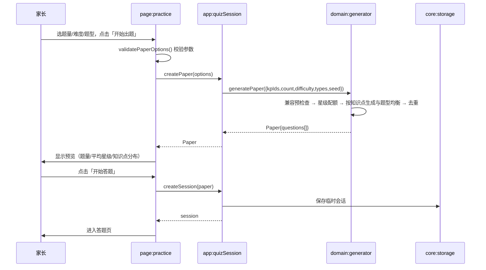
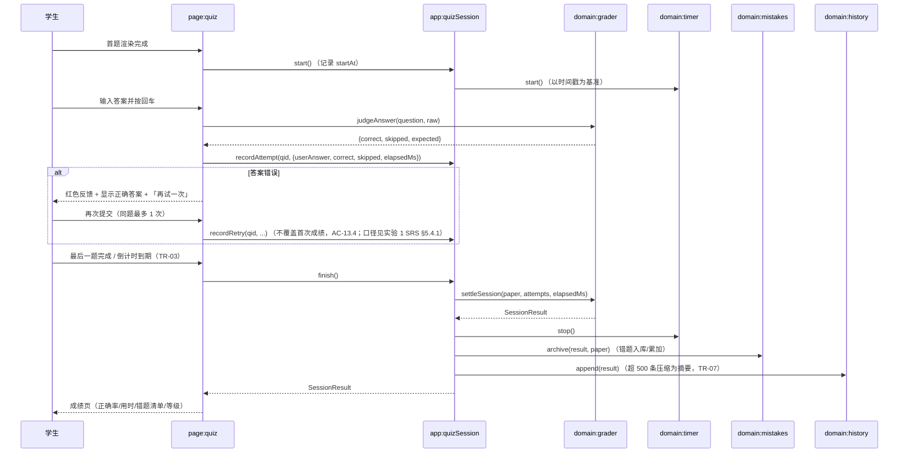
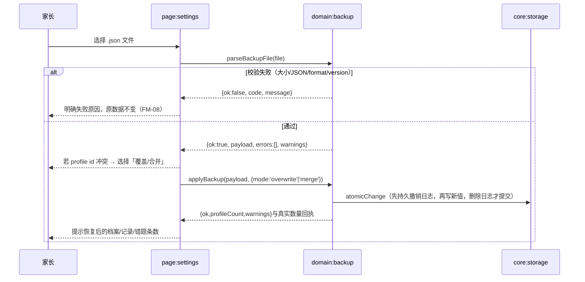
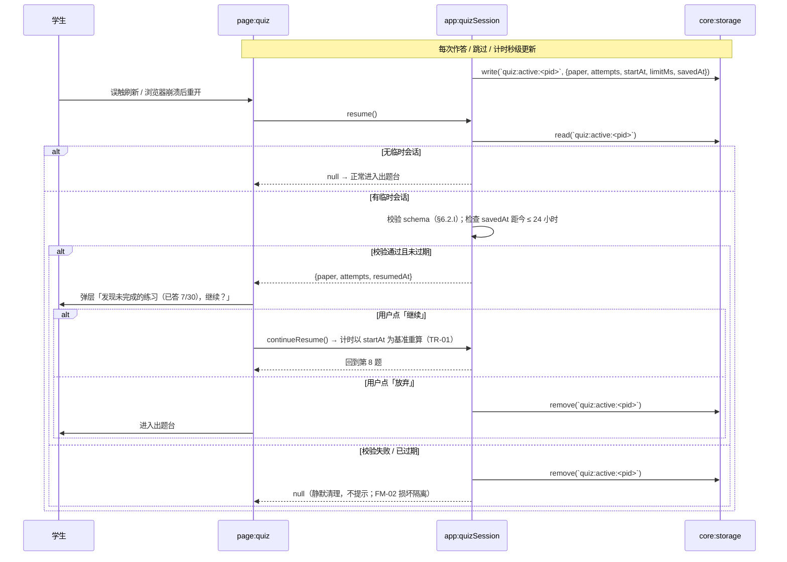
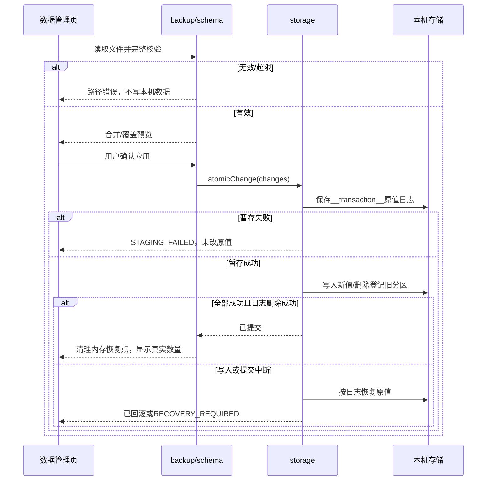

# 口算小达人 软件设计说明书（SDD）

| 项目 | 内容 |
|---|---|
| **项目名称** | 口算小达人（KidsMath） |
| **文档编号** | SDD-V1.13（三步出题向导） |
| **编写日期** | 2026 年 10 月 25 日；2026 年 10 月 31 日修订 |
| **编写人** | 黄磊（个人完成） |
| **需求基线** | 实验 1《需求规格说明书》V1.5（[`02-需求分析/03-需求规格说明书.md`](../02-需求分析/03-需求规格说明书.md)） |
| **需求基线改动** | CR-20261025-01：取消 FR-21/25/26 及相关打印约束；CR-20261025-02：写回纯白极简界面。另按CR-20261030-01修订备份校验与恢复，需求编号保留，详见 §0.2及§13.11 |
| **适用范围** | 本系统的实现、测试与验收依据 |

> **现行版本**：SDD V1.13、SRS V1.5。2026-10-31按用户要求将出题拆为选择年级→选择知识点→设置并出题，详见§13.13；本地SW为abc-4，仍为36个JS模块/42个缓存资源。业务接口、存储格式和25条FR/141条功能AC不变。选择面板见§13.12，ABC集成与安全恢复见§13.11。本次验证与发布进度见[三步向导记录](../04-测试/22-三步出题向导.md)。

---

## 0. 需求来源与基线

### 0.1 需求基线来源

需求基线为**实验 1 的需求分析文档**，本设计不重新定义需求，只给出承接关系：

| 基线元素 | 来源文件 | 本设计引用方式 |
|---|---|---|
| 功能需求 25 条（FR-21/25/26 撤销；8 个有效模块） | SRS V1.5 §3、§6 | 追溯矩阵 §12 直接使用原编号 |
| 验收标准 AC-01.1 ~ AC-28.6（141 条有效） | SRS V1.5 §3、§9.5 | 追溯矩阵给出规格级 AC；验收用例见实验 1 的 `08-需求验收用例清单.md` |
| 非功能需求 NFR-01 ~ NFR-09 | SRS V1.5 §7 | §8 逐条给出设计应对 |
| 时间相关需求 TR-01 ~ TR-10 | SRS V1.5 §5.1 | §4、§5 给出实现路径 |
| 故障模式 10 条（FM-06/07 撤销） | SRS V1.5 §5.2 | §9 逐条给出处理与恢复 |
| 统计口径与去重键 §5.4 | SRS V1.5 §5.4 | §6 给出存储字段与计算位置 |
| 设计与实现约束 DC-1 ~ DC-6（DC-7 撤销） | SRS V1.5 §2.3 | §1.3、§10 |

### 0.2 需求基线变更说明

V1.1 曾沿用 SRS V1.3 且未改需求；V1.2 根据用户 2026-10-25 明确指令更新至 SRS V1.4：

| 变更 | 原条目 | 当前处置 | 设计影响 |
|---|---|---|---|
| CR-20261025-01 | FR-21/25/26、NFR-10、DC-7、AS-4、FM-06/07；NFR-02.2、NFR-06.6 | 撤销打印及 20 条功能 AC；NFR-02.2 改为开始页至首题 ≤3 次主操作点击 | 删除打印模块、接口、界面、流程 F6 与打印测试；保留预览、屏幕竖式、错题重练、FR-28 JSON 备份 |
| CR-20261025-02 | TR-10、NFR-06.5 | 系统主题改变也保持白色界面 | 延续已实现的白色极简样式；不开发主题切换 |
| CR-20261030-01 | FR-28、SRS §4.4、NFR-03 | 导入严格校验替代静默跳过/改年级；标准1.0格式附加防重元数据，支持旧C转换 | 备份schema、持久撤销日志、启动恢复与内存失效；详见§13.11及[变更说明](../06-过程管理/04-ABC集成与备份校验变更说明.md) |

完整影响、数字复算和历史位置见 [变更说明](../06-过程管理/01-取消打印功能变更说明.md)。以下三项历史澄清仍适用：

V1.3 未增加或撤销需求，只纠正难度收窄对原知识点语义的破坏，补足 AC-09.3/09.4 的星级配额和 FR-10 的题型兼容处理；影响与接口兼容说明见 §13.3。功能需求与验收编号、条数、优先级均不变。

| 事项 | 状态 | 说明 |
|---|---|---|
| 原始需求 RN-12「全班统一份题」 | 沿用实验 1 结论 | 实验 1 已在 SRS §8.3、§9.6 将其列为 Won't（访谈无原话支撑、与零服务端冲突）。本设计**不实现**试卷分享，§12 中 N/A 一栏注明退出条件 |
| 设计草案 `docs/03-设计/02~04` 中的 FR 引用 | 视为**无效草稿** | 草案阶段的引用早于 SRS V1.4，存在编号漂移（如把 AC-20.x 的变式题写成"3 道"）。本设计以 SRS V1.4 为准，草稿不再作为依据 |
| "答题界面"同时含 FR-12（界面）与 AC-13（判分） | 未改 | 判分逻辑在 Domain、界面在 UI，设计上分开承担，见 §12 |

### 0.3 与实验 1 的可追溯文件

| 本设计章节 | 对应实验 1 文件/章节 |
|---|---|
| §0、§12 | `02-需求分析/03-需求规格说明书.md` §6、§8、§9.5、§9.6 |
| §6.4 统计口径 | SRS §5.4 |
| §9 故障处理 | SRS §5.2 FM-01~05、FM-08~12 |
| §11 验证 | `02-需求分析/08-需求验收用例清单.md` |

### 0.4 自包含性声明（便于独立评审）

实验 2 只提交本文档，而本文引用了实验 1 的条款。为保证**不打开其它文件也能核对**，凡本文依赖的基线内容，均在本文内**原文或等价形式**给出：

| 基线内容 | 实验 1 出处 | 本文内的自包含位置 |
|---|---|---|
| 25 条有效功能需求（编号、名称、优先级） | SRS §6、§9.3 | 表 0-1 |
| 9 条有效非功能需求（编号、指标） | SRS §7 | 表 0-2 |
| 10 条时间需求 TR-01~10 | SRS §5.1 | 表 0-3 |
| 10 条有效故障模式 FM-01~05、FM-08~12 | SRS §5.2 | §9（含检测点与处理） |
| 验收标准编号 AC-xx.y / TC-AC-xx.y | SRS §3、08 清单 | §12 追溯矩阵 T 列；AC-KB 出处见表 0-4 |
| 统计口径（正确率、掌握度、去重键） | SRS §5.4 | §6.4.3、§6.4.5 |

#### 表 0-1 功能需求基线（共 25 条有效；Must 14 / Should 9 / Could 2）

| 编号 | 名称 | 模块 | 优先级 |
|---|---|---|---|
| FR-01 | 创建孩子档案 | M1 | Must |
| FR-02 | 切换与编辑档案 | M1 | Must |
| FR-03 | 删除档案 | M1 | Should |
| FR-04 | 知识点大纲浏览 | M2 | Must |
| FR-05 | 知识点筛选与检索 | M2 | Should |
| FR-06 | 教材对标校验 | M2 | Must |
| FR-07 | 智能组卷 | M3 | **Must** |
| FR-08 | 题量设置 | M3 | Must |
| FR-09 | 难度分级 | M3 | Should |
| FR-10 | Should | M:generator / I:buildVerticalLayout | `layout` | 答题/在线预览 | T:10.1~10.5 | NFR-04、NFR-06 |
| FR-11 | Should | M:generator, `ui:paper` / I:`renderPaper.start/regenerate/removeQ`、`createSession` | `Paper.stats` | 预览页 | T:11.1~11.6 | NFR-02 |
| FR-12 | 答题界面 | M4 | Must |
| FR-13 | 即时判分 | M4 | Must |
| FR-14 | 倒计时与计时 | M4 | Should |
| FR-15 | 答题激励反馈 | M4 | Could |
| FR-16 | 自动批改与成绩结算 | M5 | **Must** |
| FR-17 | 练习历史记录 | M5 | Must |
| FR-18 | 错题自动归档 | M6 | Must |
| FR-19 | 错题重练 | M6 | Must |
| FR-20 | 举一反三 | M6 | **Must** |
| FR-22 | 正确率趋势统计 | M7 | Should |
| FR-23 | 知识点掌握度统计 | M7 | Should |
| FR-24 | 练习量与打卡统计 | M7 | Could |
| FR-27 | 数据本地持久化 | M9 | Must |
| FR-28 | 数据导出与导入 | M9 | Should |

FR-21/25/26 已撤销，保留原编号，不重新编号。

#### 表 0-2 非功能需求基线

| 编号 | 指标（摘要） |
|---|---|
| NFR-01 | 性能：首屏本地 <1s / Slow 3G <3s；30 题生成 <50ms；单题判分 <100ms；图表 <200ms；静态资源 <300KB |
| NFR-02 | 易用：5 位陌生家长 ≥4 人 60 秒内出卷；开始页→首题 ≤3 次主操作点击；触控 ≥44px；题目字号 ≥32px；主要操作 100ms 内反馈 |
| NFR-03 | 可靠：答案 100% 正确；损坏降级不白屏；提示可理解；刷新不丢已保存数据 |
| NFR-04 | 兼容：Chrome/Edge/Safari/Firefox 近两年版本；360~1920px；横竖屏；iOS 可添加到主屏 |
| NFR-05 | 安全：不采集、不上传；无第三方统计；仅存业务数据；导入做格式与范围校验 |
| NFR-06 | 可访问：正文对比度 ≥4.5:1；图形 ≥3:1；色盲可辨；不依赖颜色；键盘可完成核心操作；浅色/深色系统主题下均保持白色界面 |
| NFR-07 | 可维护：四层单向依赖；新增知识点只改大纲配置；注释密度 ≥15%；统一命名 |
| NFR-08 | 可移植：免构建；任意静态托管；PWA 可安装 |
| NFR-09 | 容量：≤3 档案；每档案 500 条完整 + 2000 条摘要；≤500 道错题；接近上限提示导出 |

#### 表 0-3 时间相关需求基线

| 编号 | 摘要 |
|---|---|
| TR-01 | 计时基于时间戳差值；后台 30 秒返回偏差 ≤1 秒 |
| TR-02 | 单题耗时 = 渲染完成到提交；跳过记 0 |
| TR-03 | 倒计时到期立即结算，未答计跳过 |
| TR-04 | 跨零点以**结束时刻**归属日期 |
| TR-05 | 打卡按本地自然日；断档则连续天数归零 |
| TR-06 | 统计范围按**记录条数**截取（7/30/全部） |
| TR-07 | 500 条完整 + 2000 条摘要；超 2500 删除最早摘要 |
| TR-08 | 备份文件名含导出日期 |
| TR-09 | 知识点若已下线，统计时跳过而非报错 |
| TR-10 | 系统主题变化时仍保持纯白界面，无主题切换入口 |

#### 表 0-4 AC-KB 编号出处

| 编号 | 出处 | 本文章节 |
|---|---|---|
| AC-KB.1~5 | 实验 1 SRS V1.4 **§5.5**（由 NFR-06.4 拆分而来） | §8 NFR-06 行、§11.2 界面层测试 |

---

## 1. 设计概览

### 1.1 问题与目标

| 项 | 内容 |
|---|---|
| **核心问题** | 1~3 年级家长每天为孩子口算作业"出题、批改、抄错题"耗费 15~30 分钟机械劳动；纸质作业无法用纯屏幕答题替代 |
| **目标用户** | 家长（主要操作者）、学生（答题者）、老师（间接用户，与家长共同查看设备上的结果与统计） |
| **核心功能** | 按知识点组卷、在线答题、自动判分、错题归档与变式重练、学情统计、多孩档案、本地数据备份 |
| **非功能目标** | 出题 <50ms、判分 <100ms、首屏 <1s（本地）/ <3s（Slow 3G）、资源 <300KB、答案 100% 正确、零服务端、零第三方依赖 |
| **规模约束** | 个人作业；纯前端；6 周周期；目标代码 4000~6000 行（不含注释） |

### 1.2 设计范围

- **包含**：浏览器端单页应用（SPA）、本地数据存储、离线缓存（Service Worker）。
- **不包含**：服务端、账号体系、云同步、试卷分享（Won't）、OCR。

### 1.3 设计原则

| # | 原则 | 落地方式 | 对应需求 |
|---|---|---|---|
| DP-1 | 零第三方依赖 | 全部代码自研；图表手写 SVG；离线缓存自写 Service Worker | DC-1、NFR-05.2 |
| DP-2 | 零构建 | 原生 ES Module，源码即部署产物 | NFR-08.1 |
| DP-3 | 单向分层依赖 | UI → Application → Domain → Core → Utils | NFR-07.1 |
| DP-4 | 配置驱动出题 | 知识点只写"数值约束规格"，引擎不认识具体知识点 | NFR-07.2、FR-06 |
| DP-5 | 数据在本机 | 所有读写经 `core/storage`，全应用无网络请求（除加载静态资源） | DC-2、NFR-05.1 |
| DP-6 | 数据与视图分离 | 预览、答题、历史共用题目和成绩数据；JSON 备份使用独立格式校验 | FR-11、FR-17、FR-28 |
| DP-7 | 纯函数优先 | 出题、判分、结算、统计为纯函数，输入输出确定，可单测 | NFR-03、§11 |

---

## 2. 架构设计

### 2.1 架构风格与选型理由

采用**分层单体（Layered Monolith）+ 事件总线解耦**，而非桌面/前端框架或微前端：

| 备选方案 | 优点 | 不选的理由 |
|---|---|---|
| React/Vue + Vite | 生态成熟、组件化 | 引入构建与第三方运行时，违反 DC-1/DP-2；对 12 页面的规模属过度设计 |
| 后端 + 数据库 + 账号 | 支持多端、分享 | 违反 DC-2（数据不外传）与零成本部署要求；家长访谈明确反感注册 |
| 预置题库 | 实现简单 | 题库有限、天然重复，无法支撑"举一反三"（FR-20）与知识点定向（FR-04/05） |
| **分层 + ES Module + 事件总线** | 职责清晰、可单测、零依赖 | — |

**结论**：分层单体与本项目规模匹配（25 条有效 FR、12 个页面、预计 40+ 文件），不为炫技拆分为微服务或采用框架。

### 2.2 分层结构

```
┌──────────────────────────────────────────────────────────────┐
│ L5 入口层    index.html · manifest.webmanifest · sw.js        │
│             负责挂载、PWA 清单、离线缓存                       │
├──────────────────────────────────────────────────────────────┤
│ L4 界面层    src/ui/                                          │
│   pages/      12 个页面（只管渲染与事件转发，不含业务规则）      │
│   components/ 组件（题目卡、数字键盘、统计条、Toast）           │
│   charts/     手写 SVG 图表（折线、条形、热力格）               │
├──────────────────────────────────────────────────────────────┤
│ L3 应用层    src/app/                                         │
│   quizSession  练习会话状态机（出题→答题→结算）                 │
│   profileScope 当前档案作用域（切换档案时隔离/恢复）             │
│   backup       JSON 备份下载与文件导入协调                              │
├──────────────────────────────────────────────────────────────┤
│ L2 领域层    src/domain/                                      │
│   syllabus · generator · grader · variants                    │
│   mistakes · stats · history · timer · backup                 │
│   （纯函数为主，只依赖 Core 与 Utils）                          │
├──────────────────────────────────────────────────────────────┤
│ L1 核心层    src/core/                                        │
│   storage（localStorage 封装/降级/迁移） · bus（事件）          │
│   router（hash 路由） · schema（数据结构与校验）                │
├──────────────────────────────────────────────────────────────┤
│ L0 工具层    src/utils/                                       │
│   random · format（答案规范化/分数/小数） · date · dom           │
└──────────────────────────────────────────────────────────────┘
```

**依赖规则（可静态检查）**：

| 规则 | 说明 | 检查方式 |
|---|---|---|
| R-1 | L0 不导入任何其它层 | `grep "^import" src/utils/*.js` 只允许同目录 |
| R-2 | L1 只导入 L0 | 同上 |
| R-3 | L2 只导入 L0、L1 | 禁止导入 `src/ui`、`src/app` |
| R-4 | L3 只导入 L0~L2 | — |
| R-5 | L4 只导入 L0~L3；页面不得直接调用 `storage` | 页面文件不得出现 `from '../core/storage.js'` |
| R-6 | 禁止循环导入 | 用脚本遍历 import 图检测环 |

### 2.3 部署与运行视图

```
   开发者                         用户
     │                              │
     │ git push                     │ 手机/电脑浏览器
     ▼                              ▼
┌─────────┐  Pages 构建   ┌────────────────────────────┐
│ Gitee   │ ────────────► │ 静态文件服务（Gitee Pages）  │
│ 仓库    │               │  index.html, src/**, ⬇     │
└─────────┘               │  assets/**, manifest, sw.js │
                          └──────────────┬─────────────┘
                                         │ 首次联网加载全部静态资源
                                         ▼
                          ┌────────────────────────────┐
                          │ 浏览器运行时                │
                          │  ┌──────────────────────┐  │
                          │  │ Service Worker 缓存   │  │
                          │  └──────────────────────┘  │
                          │  ┌──────────────────────┐  │
                          │  │ SPA（ES Module）      │  │
                          │  └──────────┬───────────┘  │
                          │             ▼              │
                          │  ┌──────────────────────┐  │
                          │  │ localStorage（km:*）  │  │
                          │  └──────────────────────┘  │
                          └────────────────────────────┘
```

**运行顺序**：
1. 浏览器请求 `index.html` → 加载 `src/main.js`（ES Module）。
2. `main` 依次执行：`storage.migrate()` → `ensureProfile()` → `router.start()`。
3. `router` 根据 `location.hash` 渲染页面；无 hash 时跳转 `#/home`。
4. `app/pwa.initPwa()` 注册同目录 sw.js，按 ASSETS 完整预缓存；核对完整性后显示“离线已就绪”。
5. 缓存完整后支持离线出题、答题、历史与刷新；首次未缓存断网需联网打开，缓存丢失走 FM-12 降级/恢复（§13.8）。

**版本升级**：发布时递增 sw.js 的 VERSION → 新 SW 完整预缓存后等待 → 关闭所有旧应用页面后激活 → 仅清理同作用域旧缓存。不调用 skipWaiting，不强制刷新；失败保留旧版，支持重试。不触碰 localStorage。详细状态及修复约定见 §13.8。

### 2.4 运行时进程/线程与数据流视图

```
用户事件 ──► page handler ──► app/quizSession（状态机）
                                   │  调用
                                   ▼
                            domain/*（纯函数）
                                   │  读写
                                   ▼
                            core/storage ──► localStorage
                                   │
                                   │ 发布事件 data:changed / storage:error
                                   ▼
                            core/bus ──► 相关页面订阅并刷新
```

---

## 3. 模块设计

### 3.1 模块清单与职责

| 模块 | 路径 | 职责（单一） | 不负责 | 对应需求 |
|---|---|---|---|---|
| syllabus | `domain/syllabus.js` | 24 个知识点的定义、查询、筛选、年级默认组合 | 生成题目 | FR-04、FR-05、FR-06.4 |
| generator | `domain/generator.js` | 按知识点规格生成题目；难度收窄；去重键 | 存数据、判分 | FR-06、FR-07~09、FR-10、FR-11 |
| grader | `domain/grader.js` | 单题判分、整卷结算、等级判定 | 持久化 | FR-13、FR-16 |
| variants | `domain/variants.js` | 由错题反推规格并生成同型新题 | 错题存储 | FR-20 |
| mistakes | `domain/mistakes.js` | 错题归档/去重/次数累计/攻克/清空 | 判分 | FR-18、FR-19 |
| history | `domain/history.js` | 练习记录写入、查询、筛选、压缩为摘要 | 统计计算 | FR-17、TR-07 |
| stats | `domain/stats.js` | 趋势、掌握度、练习量与打卡 | 绘图 | FR-22~24、TR-05/06 |
| timer | `domain/timer.js` | 练习计时、倒计时（基于时间戳） | 界面展示 | FR-14、TR-01~03 |
| profile | `domain/profile.js` | 档案增删改、当前档案、多档案隔离 | 数据迁移 | FR-01~03 |
| backup | `domain/backup.js` | 导出结构组装、导入校验链 | 下载动作 | FR-28、§4.4 |
| storage | `core/storage.js` | 键前缀读写、降级、损坏处理、版本迁移 | 业务语义 | FR-27、FM-01~03 |
| bus | `core/bus.js` | 事件发布/订阅 | 业务 | — |
| router | `core/router.js` | hash 路由与页面挂载 | 页面内容 | — |
| schema | `core/schema.js` | 数据结构常量与运行时校验 | 存储 | §6 |
| ui/pages | `ui/pages/*.js` | 12 个页面的渲染与事件转发 | 业务规则 | 25 条有效 FR 的界面部分，已排除 FR-21/25/26 |
| ui/components | `ui/components/*.js` | 可复用控件 | — | FR-12、FR-15、NFR-02 |
| 统计视图 | `ui/pages/stats.js` | 趋势 SVG、掌握度条形图与日历 DOM/CSS、文字表 | 统计口径由 domain/stats 提供，不另建第三方图表库 | FR-22~24、NFR-06 |

### 3.2 模块内部结构示例

**generator（配置驱动）**

```
generator.js
├── 对外：validatePaperOptions(opts)  难度与题型兼容预检查
├── 对外：generatePaper(opts)          组卷
├── 对外：generateQuestions(kpId,n)     单知识点批量
├── 对外：regenerateQuestion(q,exclude) 换一题
├── 对外：adjustSpec(spec,difficulty)   难度收窄
├── 对外：dedupeKey(q,commutative)      去重键
├── 对外：buildVerticalLayout(q)        竖式排版
└── 内部：genAdd/genSub/genMul/genDiv/genMix/genCompare/genFraction
          （每个只读 spec，不读全局状态）
```

**边界**：generator 只接收 `kpIds/count/difficulty/types/seed`，返回纯数据对象，不触碰 storage；因此可以在 Node 或无 DOM 环境中直接单测。

### 3.3 耦合分析

| 关系 | 类型 | 说明 |
|---|---|---|
| generator → syllabus | 数据依赖（单向） | generator 查询知识点规格；syllabus 不知道 generator |
| quizSession → generator/grader/timer | 控制依赖 | 会话状态机编排顺序 |
| mistakes / variants → generator | 函数复用 | variants沿用生成器排除键；mistakes使用保留题型/空位的mistakeKeyOf，见§6.4.5及§13.10 |
| ui → app → domain | 调用依赖 | 页面不直接调用 domain 持久化函数 |

---

## 4. 关键流程设计

> 时序图中的模块名对应 §3，接口签名见 §5，字段见 §6。

### 4.1 流程 F1：出卷（家长主路径）

**正常路径**



**分支路径**

| 分支 | 条件 | 行为 |
|---|---|---|
| B1 | 初次进入、未指定知识点 | 页面使用当前档案年级默认组合（AC-07.6）；用户主动全不选后须重新选择，参数检查返回 NO_KNOWLEDGE_POINTS |
| B2 | 题量超界 | 钳制到 5~100 并提示实际题量（AC-08.3） |
| B3 | 难度占比无法满足 | 出题前提示重新选择，不引入未选知识点（AC-09.3/09.4） |
| B4 | 知识点空间不足 | 先放宽为二级去重，再向已选且题型匹配的知识点转嫁；不足时减少实际题量，仍须达到星级比例并显示差额（FM-04） |
| B5 | 参数矛盾无法生成 | 达到有界尝试上限后终止并提示（FM-05），组卷与单题替换上限见下文 |
| B6 | 部分知识点/题型无交集 | 生成前列明本次不出题的知识点及无法生成的题型；有解部分继续生成，预览保留说明，不偷偷改变题型 |
| B7 | 所有知识点/题型无交集 | 返回 UNSUPPORTED_COMBINATION，提示调整知识点或题型，不生成预览 |

B03 本地落地路径为 `page:practice → domain:validatePaperOptions/generatePaper → Paper → createSession`；尚未独立抽取的 `app:createPaper` 和预览调整页仍为后续目标。生成内部每轮尝试有上限（`max(需要题数×40,400)`），补缺最多 6 轮；单题替换最多 200 次。返回空卷时抛出 GENERATION_EXHAUSTED，禁止进入答题。

### 4.2 流程 F2：在线答题与结算



**异常路径**

| 异常 | 处理 | 依据 |
|---|---|---|
| 倒计时到期 | 立即结算，未答题计跳过不判错 | TR-03 |
| 退出练习确认后 | 按已作答内容结算；0 题作答则不产生记录 | FR-12.7；口径见 SRS §5.4.2 |
| 切到后台 | 计时基于时间戳差值，不因定时器节流而变慢 | TR-01 |
| 存储写入失败 | 内存保留最新数据，提示导出备份 | FM-03 |

### 4.3 流程 F3：错题重练与举一反三

```
错题本页 ──选择范围──► 组装 variantPaper
                          │
        ┌─────────────────┴──────────────────┐
        ▼                                    ▼
 「重练原错题」                          「举一反三」
 （取 Mistake 中的原题）               （variants.generate(mistake)）
        │                                    │
        │                     反推 spec：知识点 + 题型 + 操作数结构 + 难度
        │                                    ▼
        │                      循环生成 → dedupeKey 排除原卷与原题 → 凑满 5 道
        │                      （同星级；不足时 ≤1 星差异并标注，AC-20.4）
        ▼                                    ▼
               进入答题会话（复用 quizSession，mode='retry' | 'variant'）
                          │
                          ▼
               结算后：原题重练首次答对 → mastered=true；首次答错 → wrongCount++
               变式全对仅给专项提示，不凭不同题目自动攻克原题
               掌握度计入重练与变式（SRS §5.4.3）
```

**F3-异常分支：变式题凑不满 5 道**

```
variants.generate(mistake, n=5)
  │
  ├─ 阶段 A：同知识点 + 同题型 + 同星级 + 未出现在原卷 + 未出现在已生成列表
  │    来源：knowledgePoint.spec 经 adjustSpec(spec, starOf(mistake)) 收窄
  │    条件：guard < 400 次尝试且已生成 < 5
  │    ▼ 不足
  ├─ 阶段 B：允许星级 ±1（与原题相差 ≤1 星），逐题标注「难度略高 / 略低」（AC-20.4）
  │    条件：guard 再增 400 次；排除同上
  │    ▼ 仍不足
  └─ 阶段 C：按实际可生成数返回（0 < k < 5）
       变式页提示：「该知识点同类题只有 k 道，已全部给出」
       不在未选知识点中取题（AC-09.x 不引入未选知识点）
       ▼ k = 0（知识点题量本就极少）
       提示：「这个知识点可生成的同类题不足，建议直接重练原题」
       提供「重练原题」按钮（回退到 F3 左侧分支）
```

**为什么允许降级而不是无限等待**：知识点规格空间有限（如"100 以内整十数加减"可能的组合数远大于 5，但"同题型的竖式 + 同星级"可能只剩 2~3 道可用），若不降级会陷入 200 次重试后返回 `null`（FM-05）的体验；按实际数量返回并说明原因，比报错更能服务家长。

### 4.4 流程 F4：导入备份



**一致性策略**：V1.11采用`km:__transaction__`持久撤销日志，先完整暂存受影响键的原始字符串，再写新值，删除日志成功才提交；失败或启动时按日志恢复。暂存不足不改原值，未恢复完成禁止继续写入，详见§13.11。原临时键构想不作为当前实现接口。

### 4.5 流程 F5：刷新后恢复进行中的练习（对应 §9.1 恢复点）



**关键约束**：
- 临时键与正式记录分开，**结算成功后**才写 `sessions` 并删除临时键；先写正式记录、后删临时键（若中途失败，最多重复恢复一次，不会丢数据）。
- 临时会话只属于当前档案；切换档案时旧档案的临时会话保留，切回时仍可恢复。
- 恢复后答题的首次成绩口径不变：已答题目视为已记录，不重复计分（§6.2.H `Attempt.first`）。

### 4.6 已撤销流程编号 F6

原打印流程随 CR-20261025-01 撤销。当前不创建打印 DOM、不调用系统打印对话框、不提供 PDF 练习卷。F1 预览→在线答题、F3 错题重练与 F4 JSON 备份导入继续有效。

---

## 5. 接口设计

> 接口为 ES Module 函数，输入输出均为普通 JS 对象。错误约定统一如下：
> - **业务可恢复错误**：返回 `{ok:false, code, message}`，不抛异常；
> - **编程错误/参数非法**：抛 `Error`（调用方属于程序缺陷，应在开发期暴露）；
> - **无返回值语义的函数**：返回 `void`，通过 `core:bus` 事件通知结果。

### 5.1 领域层接口

#### 5.1.1 syllabus

| 接口 | 签名 | 输入 | 输出 | 错误 |
|---|---|---|---|---|
| 查询年级知识点 | `getKnowledgePoints(grade)` | `grade: 1\|2\|3` | `KnowledgePoint[]` | grade 非法返回 `[]` |
| 查询知识点 | `getKnowledgePoint(id)` | `id: 'G1-03'` | `KnowledgePoint \| null` | 不存在返回 `null` |
| 筛选 | `filterKnowledgePoints({grade, keyword, type, maxDifficulty})` | 全部可选 | `KnowledgePoint[]` | 无 |
| 年级默认组合 | `getGradeDefaultKPs(grade)` | `grade` | `string[]`（kpId） | 无 |
| 公共题型 | `commonTypes(kpIds)` | `string[]` | `string[]` | 空输入返回 `[]` |

#### 5.1.2 generator

```ts
/** 组卷参数 */
interface PaperOptions {
  kpIds: string[];          // 至少 1 个，必须存在于大纲
  count: number;            // 生成请求 5~100，超界钳制；编辑后实际 count 见 §6.2.G
  difficulty: 'easy' | 'normal' | 'hard';
  types: QuestionType[];    // 与知识点支持题型取交集
  seed?: number;            // 可选，用于可复现测试
  excludeKeys?: Set<string>; // 可选调用参数；不保存到 Paper.options
}

/** 题目 */
interface Question {
  id: string;               // 唯一 id
  kpId: string;             // 知识点编号
  type: QuestionType;       // horizontal|vertical|compare|fill|chain
  op: 'add'|'sub'|'mul'|'div'|'compare'|'mix';
  kind: 'int'|'decimal'|'fraction'|'remainder'|'symbol';
  text: string;             // 展示文本，如 "37 + 25 = ___"
  answer: string;           // 规范化标准答案
  difficulty: 1|2|3;        // 星级
  params: object;           // 生成参数，供变式题反推
  layout?: VerticalLayout;  // 仅竖式题
}

generatePaper(opts: PaperOptions): Paper
  // 参数错误抛出带 code 的 Error；错误约定见下表
  // 返回 Paper { id, questions, stats, createdAt, options, shortfall, warnings:string[] }

validatePaperOptions(opts: Pick<PaperOptions, 'kpIds'|'difficulty'|'types'>): {
  ok: boolean; code?: string; message?: string;
  kpIds: string[]; types: QuestionType[];
  eligibleKpIds: string[]; skippedKpIds: string[]; warnings: string[];
}

generateQuestions(kpId: string, n = 10, opts?): Question[]
regeneratePaper(paper: Paper, previousKeys?: Set<string>): Paper
  // 按 options.requested 重出；排除当前题目与 previousKeys，原 Paper 不变
regenerateQuestion(q: Question, exclude: Set<string>): Question | null
  // 200 次仍无法生成不重复题目时返回 null
adjustSpec(spec, difficulty): Spec
dedupeKey(q: Question, commutative = true): string
  // 格式见 §6.4.5；同卷内及错题本共用
buildVerticalLayout(q: Question): VerticalLayout
```

**调用限制**：`count ≤ 100`、`kpIds.length ≤ 24`；单次生成预计 <5ms，不做异步。

**B03 返回与错误约定**：预检查不消耗随机数、不更改传入对象；知识点 ID 与题型去重；兼容项才参与分配。`generatePaper` 复用同一检查，失败时抛 `Error` 并带 `.code`，不返回空卷。`options.kpIds` 保留原选择；`options.requested` 为纠正后的请求量，`options.count` 为实际题量。B04 已增加下述 stats 字段，B05 已在内联预览提供调整，见后述接口与 §13.5。

**B04 统计接口**：`domain/paper.calculatePaperStats(questions:Question[]): {total:number, avgStar:number, dist:Record<string,number>}`。不更改题目、不读存储；total 为当前数组长度，avgStar 为全部题目星级的算术平均、四舍五入到一位小数，dist 按 kpId 累计实际题数。空数组返回 `{total:0,avgStar:0,dist:{}}`。生成器在返回时填入 `Paper.stats`；UI 用同一函数从当前 questions 重算，兼容旧 Paper 无 stats 的情况。展示时 avgStar 使用 toFixed(1)，并绘制三颗星的相应填充图示；图示 aria-hidden，读屏读取数字。分布按题数降序、同数按 kpId 升序；占比为 round(题数×100/total)，独立取整允许合计 99%/101% 并说明。

| code | 条件 | 页面处理 |
|---|---|---|
| NO_KNOWLEDGE_POINTS | 无有效知识点 | 提示至少选择一个 |
| INVALID_DIFFICULTY / INVALID_QUESTION_TYPES | 档位非法、题型为空或含未知值 | 要求重新选择 |
| UNSUPPORTED_COMBINATION | 全部知识点与所选题型均无交集 | 提示调整，不切换到未选题型 |
| DIFFICULTY_UNAVAILABLE | 兼容知识点中无简单所需 1 星或挑战所需 3 星 | 提示增选匹配知识点或改为适中，不篡改星级 |
| GENERATION_EXHAUSTED | 有限尝试后无题，或无符合星级比例的题 | 提示调整，不进入答题 |
| REGENERATION_EXHAUSTED | 排除上一批题目后无可用新题 | 原预览及答案开关状态保留，提示调整条件 |

**B05 编辑接口（domain/paper）**：`removePaperQuestion(paper,qid):Paper` 返回新对象，移除目标、重算 stats/count/shortfall 并增加 removedCount；无此 ID 返回原对象，不改入参或剩余题目 ID。`checkPaperReadiness(paper)` 返回 `{ok:true}` 或 `{ok:false,code,message}`，code 为 EMPTY_PAPER/DIFFICULTY_RATIO，分别阻止空卷或不满足简单/挑战比例的卷进入答题；生成器与编辑检查共用 DIFFICULTY_RULES。

**B05 重出约定**：`regeneratePaper(paper,previousKeys)` 使用原知识点/题型/档位/requested，并用一级去重键排除上一生成批次（包含手动删除题目）；两级去重补缺均不得绕过排除。新题不足时返回实际数量与 shortfall，空集抛 REGENERATION_EXHAUSTED。页面仅在新卷生成成功后替换原卷、新建其排除集，并关闭答案；失败保留原卷、编辑结果和答案开关。排除范围是上一批次，未承诺永不复用历史上所有练习题。页面级 Set 暂存原批次键，不落盘、不新增存储键。

`generateQuestions` 与 `regenerateQuestion` 的签名保持兼容。单知识点批量同样遵守档位条件；换题始终保留知识点与合法题型，不支持的题型或耗尽返回 `null`。A 包重练/变式保持已有知识点星级时默认用 `difficulty:'normal'`，不要为降低数值而使用缺少 1 星的 `easy` 请求。100 题 <50ms 依照 NFR-01/AC-07.3 验证；上方 <5ms 是更严的设计预期，B03 测量未将其认定为已达成。

#### 5.1.3 grader

```ts
judgeAnswer(q: Question, rawAnswer: string):
  { correct: boolean; skipped: boolean; expected: string }
  // 空串 → skipped=true；答案缺失 → skipped=true 并 console.error（FM-09）

settleSession(paper: Paper, attempts: Record<qid, Attempt>, elapsedMs: number): SessionResult
  // 不修改入参；返回新对象

gradeOf(accuracy0to100: number): { key:'excellent'|'good'|'keep', label, tip }
  // ≥95 优秀 / ≥80 良好 / <80 加油；用未取整值
```

#### 5.1.4 mistakes / history / stats / timer / backup / profile

| 接口 | 签名 | 输出 | 说明 |
|---|---|---|---|
| `archiveSession(record)` | mistakes 领域；完整结算记录含 profileId/paper/detail | `{ok,code?,archivedCount,masteredCount?}` | 同一会话幂等，重练首次正确自动攻克；失败不写半份错题 |
| `listMistakes(profileId,{kpId,status})` | `status: 'pending'\|'mastered'\|'all'` | `Mistake[]` | 页面按知识点分组；最多500道 |
| `clearMastered(profileId)` | mistakes 领域 | `{ok,removed?,code?}` | 不删除成绩、防重索引或徽章 |
| `buildRetryPaper(profileId,ids)` | 1～100条来源错题 | `{ok,paper?,code?}` | 复用 quizSession；保留来源ID |
| `buildVariantPaper(profileId,ids,{excludeKeys,seed})` | variants 领域，批量可超20条原错题 | `{ok,paper?,requested?,shortfall?,remainingIds?,code?}` | 每批至多20道原错题×5；剩余队列显式进入后续批次；不足按实际数继续 |
| `retainHistory(records)` | 结算/合并共用 | `SessionRecord[]` | 最多500明细+2000摘要，TR-07 |
| `listHistory(profileId)` / `filterHistory(rows,{from,to,kpId})` | 查询/纯筛选 | `SessionRecord[]` | 倒序，单删见§13.11 |
| `accuracyTrend(profileId,range)` | `7\|30\|'all'` | `{ok,points?,delta?,direction?,code?}` | 少于2条提示不足；按条数截取、时间与ID排序 |
| `masteryByKP(profileId)` | stats 领域 | `{kpId,name,mastery,level,correct,answered}[]` | 含摘要；未取整比率分档；升序 |
| `streakDays(profileId)` / `practiceSummary(profileId)` | stats 领域 | `number` / 练习量汇总 | 有效作答、本地自然日（TR-05） |
| `activityCalendar(profileId)` / `badges(profileId)` | stats 领域 | 56日日历 / 7、30、100日徽章与获得日期 | `updateAwards`仅在获得日期新增/提前时写最多3条 |
| `timer.start()` / `timer.elapsedMs()` / `timer.stop()` | — | number | 基于 `performance.now()` + 可见性切换补偿 |
| `buildBackup()` / `downloadBackup()` | 全档案 | 标准备份 / `{filename,bytes}` | 保留防重、徽章和设置 |
| `parseBackupFile(file)` / `inspectBackupPayload(payload)` | 文件/对象 | `{ok,payload?,errors,warnings}` | 校验链见§13.11 |
| `applyBackup(payload,{mode})` | merge/overwrite | `{ok,profileCount?,errors?,code?}` | 持久撤销日志；返回成功才更新内存 |
| `createProfile({name,grade,avatar})` | 档案字段 | Profile；失败抛错误 | 上限3，昵称≤12，空值默认 |
| `switchProfile(id)` | 档案ID | Profile或null；写入失败抛错误 | 保留各档案练习 |
| `removeProfile(id)` | 档案ID | `{removed,next}`；事务失败抛错误 | 登记键全部删除，最后档案引导创建 |
| `readStore(profileId)` / `syncMistakes(profileId)` | mistakes 领域 | 错题容器 / `{ok,code?}` | 保留窗口内完整成绩回补，摘要不复造错题 |
| `generator.validatePaperOptions(options)` | `ui/practice` 调用 | §5.1.2 的检查结果 | 难度与题型共用校验；题量由 UI 确认、generator 再钳制；页面初始年级默认选项在 renderPractice 建立 |
| `window.onerror` / `unhandledrejection` | 启动注册 | — | 阻止白屏并发布 `ui:toast`（FM-11） |

### 5.2 核心层接口

| 接口 | 签名 | 说明 |
|---|---|---|
| `storage.read(key, fallback)` | `key` 不含前缀 | 损坏时自动备份并返回 fallback |
| `storage.write(key, value)` | — | 返回 `boolean`；配额错误返回 false 并发布 `storage:error` |
| `storage.remove(key)` / `clearAll()` / `keys()` / `usedBytes()` | — | — |
| `storage.migrate()` | 启动调用 | 按 `km:meta.version` 逐版本升级 |
| `bus.on(type, fn)` | 返回取消订阅函数 | 事件名见 §5.3 |
| `router.register(path, render)` / `router.start()` / `router.go(path)` | — | hash 路由 |

### 5.3 事件约定（内部接口）

| 事件 | payload | 发布方 | 订阅方 |
|---|---|---|---|
| `profile:changed` | `{profileId}` | profile | 各页面 |
| `paper:generated` | `{paperId}` | quizSession | home/paper 页 |
| `quiz:answer` | `{qid, correct, skipped}` | quiz 页 | 组件（反馈动效） |
| `quiz:finished` | `{sessionId}` | quizSession | result 页 |
| `mistake:mastered` | `{mistakeId}` | mistakes | 错题本页、统计页 |
| `data:changed` | `{keys}` | storage | 订阅该键的页面 |
| `storage:error` | `{reason:'quota'\|'unknown'}` | storage | 全局横幅 |
| `storage:corrupt` | `{key}` | storage | 全局提示（FM-02） |
| `ui:toast` | `{text, level}` | 任意 | Toast 组件 |

**调用限制**：订阅方在页面卸载时**必须调用返回的取消函数**；`emit` 内部复制订阅集合，允许回调中取消订阅。

### 5.4 应用层与页面侧接口

> 页面（L4）只负责渲染与转发；下列接口把页面行为**收口到可命名的函数**，追溯矩阵的 F/I 列引用它们。

#### 5.4.1 应用层接口（`src/app/`）

| 接口 | 签名 | 调用方 | 输入 | 输出 | 错误约定 |
|---|---|---|---|---|---|
| 创建练习会话 | `createSession(paper,{limitMs?})` | 预览页、错题本页 | Paper；mode由paper.retry/variant推断 | `Session` 对象 | 空卷/无档案/已有练习/非法时限抛Error；恢复同模式 |
| 恢复会话 | `resumeSession(profileId)` | 答题页启动 | `—` | `Session \| null` | 结构非法/过期 → `null`，并删除临时键 |
| 提交作答 | `recordAttempt(qid, attempt)` | 答题页 | `{userAnswer, correct, skipped, elapsedMs}` | `void` | 会话不存在 → 抛 `Error('NO_SESSION')` |
| 记录纠错重试 | `recordRetry(qid, attempt)` | 答题页 | 同上 | `void` | 不覆盖首次成绩（§6.2.2） |
| 结束会话 | `finishSession()` | 答题页、倒计时到期 | `—` | `SessionResult` | 无作答 → `{ok:false, code:'NO_ANSWER'}`，不写记录 |
| 退出会话 | `abortSession()` | 退出确认框 | `—` | `SessionResult \| null` | 已答 0 题 → `null` 且不写记录 |
| 重练/变式入口 | `startMistakePractice(ids,{kind,excludeKeys})` | 错题/答题/成绩页 | kind为retry/variant | `{ok,code?,message?}`；成功自动导航答题 | 统一错误文本、题数/批次确认；取消不创建会话 |
| 导出触发 | `triggerDownload(filename, text, mime)` | 设置页 | 文本 | `{ok:true}` | 见 §5.5 下载接口 |

#### 5.4.2 页面侧接口（`src/ui/`，对外暴露给路由与组件）

| 接口 | 签名 | 职责 | 依赖的应用/领域接口 | 对应需求 |
|---|---|---|---|---|
| 开始页 | `renderHome(el)` | 提供出题、成绩历史、错题本三个入口 | router 页面导航 | FR-07、FR-17、FR-18 |
| 出题台 | `renderPractice(el)` → `{getOptions()}` | 收集并校验组卷参数 | `validatePaperOptions` | FR-07、FR-08 |
| 知识点选择 | `renderSyllabus(el)` → `{getSelection()}` | 筛选、勾选、年级一键选 | `syllabus.filterKnowledgePoints` | FR-04、FR-05 |
| 预览页 | `renderPaper(el, paper)` → `{start(), regenerate(), removeQ(qid)}` | 展示统计、调整、进入在线答题 | `createSession`、`generatePaper` | FR-11 |
| **数字键盘输入** | `mountKeypad(input,onChange,{mode='all',focusInput=true}) → HTMLElement` | 修改 input 并回调草稿；整数/小数/分数/余数 12 键，比较 4 键；旧调用 18 键；键盘激活保留按钮焦点 | `onChange(value)` → `saveDraft`；不在组件内判分 | **FR-12（AC-12.3）** |
| 物理键盘输入 | `quiz` 页原生 input 的 `input` / `keydown` 监听 | 原生输入数字、`-`、`.`、`/`；Enter 排除组合输入及 repeat 后提交 | `saveDraft`、`recordAttempt`；未独立导出 captureKeys | FR-12（AC-12.4） |
| 答题页 | `renderQuiz(root,ctx) → {dispose,beforeLeave}` | 渲染当前题、反馈、进度及焦点 | `resumeSession`、`saveDraft`、`recordAttempt(raw,{retry,skip})`、`advance` | FR-12~FR-15；B07 按实际代码校正接口 |
| 答题反馈 | `consecutiveCorrect(session) → number`；`createAnswerFeedback(onChange) → {state,setSoundEnabled,play,stop,dispose}` | 首次作答连对计数与可选音效；不处理判分 | `storage.read/write/isAvailable`、Web Audio；详见§13.9 | FR-15 |
| 成绩页 | `renderResult(root,ctx)` | 展示成绩、错题清单与首次全对庆祝；ctx.query.id指定历史记录 | `getHistoryRecord(id)`、`getLastResult()` | FR-15、FR-16、FR-17；B09按实际代码校正签名 |
| **错题本页** | `renderMistakes(el,ctx)` | 分组、勾选、重练、变式、清理及失败重试 | `startMistakePractice`、`clearMastered`、`syncMistakes` | FR-18、FR-19、FR-20 |
| 举一反三交互 | 答题/错题/成绩页 → `startMistakePractice(ids,{kind:'variant',excludeKeys})` | 复用答题会话；成绩页提供再来一组及下一批，无独立variants路由 | `buildVariantPaper`、`createSession` | FR-20 |
| 学情页 | `renderStats(el)` 返回销毁回调 | 趋势、条形图、日历、徽章与快捷练习；跨日重算 | `stats.*`，内部渲染函数 | FR-22~24 |
| 历史页 | `renderHistory(el)` | 筛选、详情、删除 | `history.list/remove` | FR-17 |
| 档案页 | `renderProfiles(el)` | 增删改切换 | `profile.*` | FR-01~03 |
| 设置页 | `renderSettings(el)` | 完整校验后预览、合并/覆盖确认、导入数量与恢复状态；共用settings.sound | `parseBackupFile/prepareImport/applyBackup/downloadBackup` | FR-27、FR-28 |

**B07 共享辅助接口（`utils/accessibility.js`）**：`focusElement(node)` 对已连接、可见且未禁用的元素执行 preventScroll 聚焦；静态标题补 tabindex=-1。`focusPage(root)` 保留页面内已有有效焦点，否则定位 h1/首个可交互元素/容器。`installKeyboardSupport()` 在启动时注册一次 document 捕获监听，仅在 #app/#topbar 内拦截激活键重复，并给原生复选框增加 Enter 切换；Space 保留原生行为。均无返回业务数据，不读写存储。内部重绘须显式调用焦点恢复，不能依赖路由再次渲染。

#### 5.4.3 图表接口（`src/ui/charts/`）

| 接口 | 签名 | 输出 | 约束 |
|---|---|---|---|
| 折线图 | `lineChart(svgEl, {points, range})` | SVG 节点 | 点 ≤ 全部保留记录（≤2500），超出按条数截取由 `stats.trend` 负责 |
| 条形图 | `barChart(svgEl, {items:[{label,value,level}]})` | SVG 节点 | 每个条必须带文字标签（AC-23.4） |
| 热力格 | `heatmap(svgEl, {days, values})` | SVG 节点 | 8 周 = 56 格 |

### 5.5 外部接口

#### 5.5.1 浏览器平台接口

| 外部系统 | 接口 | 用途 | 输入 / 输出 | 错误约定 | 调用限制 |
|---|---|---|---|---|---|
| localStorage | `getItem(k)` / `setItem(k,v)` / `removeItem(k)` | 持久化 | 入：字符串键值；出：字符串或 `null` | `setItem` 抛 `QuotaExceededError` → `storage.write` 返回 false 并发布 `storage:error`（FM-03）；初始化抛错 → 降级内存（FM-01） | 约 5MB/源（UTF-16）；**同步阻塞**，一次业务操作只写一个键（C-D5） |
| 下载 | `Blob` + `URL.createObjectURL` + `<a download>` | 导出备份 | 入：JSON 文本与文件名；出：浏览器下载 | `createObjectURL` 失败 → 返回 `{ok:false, code:'DOWNLOAD_FAILED'}` | 须用户手势；下载完成后 `revokeObjectURL` |
| 文件选择 | `<input type="file" accept=".json">` + `File.text()` | 导入备份 | 入：`File`；出：UTF-8 文本 | 读取失败 → `{ok:false, code:'READ_FAILED'}` | ≤5MB（超限在 `backup.validate` 先拒绝，不读全量） |
| Service Worker | `register(workerUrl,{scope:base.href,updateViaCache:'none'})` | 离线缓存/版本更新 | 输入为相对模块路径推导的URL；输出 ServiceWorkerRegistration；状态/修复消息见 §13.8 | 注册/安装/更新失败显示重试说明，保留已有版本，不阻塞在线功能 | HTTPS或localhost；仅同源静态GET，首次缓存必须联网 |
| Web App Manifest | `<link rel="manifest">` | 安装到主屏幕 | `manifest.webmanifest` | — | 需 HTTPS；图标 ≥192px |
| 权限 API | **不使用** | — | — | — | 不申请通知/位置/麦克风等任何权限（NFR-05） |

#### 5.5.2 第三方系统接口

**无。** 应用运行期间不发起任何跨域网络请求，不加载任何第三方脚本、字体或图表库（AC-27.5、DC-1）。
部署平台（Gitee Pages）只在发布阶段作为**静态文件托管**使用，不与应用运行时代码交互，因此不构成运行时接口。

---

## 6. 数据设计

### 6.1 存储布局

localStorage 单源，键统一前缀 `km:`，按**档案维度分区**，避免"切换档案时全量重写"：

| 键 | 内容 | 大小上限策略 |
|---|---|---|
| `km:meta` | `{version, createdAt, lastVisitAt}` | — |
| `km:profiles` | `Profile[]` | ≤3 |
| `km:active` | `profileId` | — |
| `km:settings` | `{sound, theme}` | — |
| `km:badges:<pid>` | `{version:1,items:[{id,earnedAt}]}` | ≤3 枚，earnedAt为本地YYYY-MM-DD |
| `km:sessions:<pid>` | `SessionRecord[]`（倒序，第 501 条起为摘要） | 500 完整 + 2000 摘要 |
| `km:mistakes:<pid>` | `{version:2,archivedSessions:string[],items:Mistake[]}` | 错题≤500；防重ID≤2500，见§13.10 |
| `km:__corrupt__<key>` | 损坏数据备份 `{at, raw}` | 每条截断 10KB |
| `km:__import_tmp__` | 导入临时数据（成功后并入并删除） | — |
| `km:quiz:active:<pid>` | 进行中的练习 `{paper, attempts, startAt, limitMs}` | 单会话；结算/退出后删除 |

### 6.2 实体定义

**标识与通用约定**：所有实体 `id` 由 `utils/random.makeId(prefix)` 生成，格式为 `前缀 + 时间戳36进制 + 6位以内随机36进制`（如 `p_lx3k2a7f9q`），保证同一毫秒内多次调用不冲突；时间字段一律为**毫秒时间戳（本地时区含义）**。

#### 6.2.A Profile

| 字段 | 类型 | 约束 | 说明 |
|---|---|---|---|
| `id` | string | 唯一，`p_` 前缀 | 主键 |
| `name` | string | 1~12 字符（去首尾空格）；空则 `"小朋友"` | 昵称 |
| `grade` | 1\|2\|3 | 枚举；非法回落 1 | 年级 |
| `avatar` | string | 必须来自 `AVATARS` 列表 | 头像 |
| `createdAt` | number | 毫秒时间戳 | — |

#### 6.2.B SessionRecord

| 字段 | 类型 | 约束 | 说明 |
|---|---|---|---|
| `id` | string | 唯一 | 主键 |
| `profileId` | string | 外键 → Profile | 冗余便于查询 |
| `paper` | Paper | 仅完整记录保留 | 摘要记录中 `null` |
| `total` / `correct` / `wrong` / `skipped` | int | `correct+wrong+skipped = total` | 实际题量口径 |
| `answered` | int | `answered = total - skipped` | 作答题数 |
| `accuracy` | number | 0~100，展示保留 1 位 | 用未取整值判等级 |
| `grade` | `{key,label,tip}` | 枚举 | 优秀/良好/加油 |
| `elapsedMs` | int | ≥0 | 总用时 |
| `avgMs` | int \| null | 无作答为 `null` | `elapsedMs / answered` 取整 |
| `wrongList` | `{question:Question,userAnswer,expected}[]` | 仅完整记录 | 完整题目快照；归档以首次detail重新判分 |
| `kpCount` | Record<kpId,int> | — | 知识点构成（摘要也保留） |
| `kpCorrect` / `kpAnswered` | Record<kpId,int> | 仅摘要（完整记录可由 paper 推导） | 掌握度累计 |
| `finishedAt` | number | 本地时间戳 | 跨零点归属以结束时刻为准（TR-04） |
| `compressed` | boolean | — | 是否摘要 |

#### 6.2.C Mistake

| 字段 | 类型 | 约束 | 说明 |
|---|---|---|---|
| `id` | string | 唯一 | 主键 |
| `key` | string | 去重键（§6.4.5），档案内唯一 | 唯一约束 |
| `kpId` / `type` | string | 外键 | — |
| `text` / `answer` / `userAnswer` | string | — | — |
| `params` | object | 用于变式题反推 | — |
| `wrongCount` | int | ≥1 | 再次答错 +1 |
| `mastered` | boolean | 默认 false | 重练答对后 true |
| `firstWrongAt` / `lastWrongAt` | number | — | — |
| `firstUserAnswer` | string，可缺省于旧V1记录 | 新记录保留首次错误答案 | 不把旧版已覆盖的答案伪称为首次 |
| `question` | Question | 完整题目快照 | 原题重练及变式来源 |
| `sourceSessions` / `sourcePaperKeys` | string[] | ≤10 / ≤100 | 最近来源会话及最初原卷排除键；原卷压缩后仍可排除 |
| `masteredAt` | number，可缺省 | 攻克时刻 | 回补更早错误不覆盖较新攻克状态 |

#### 6.2.D KnowledgePoint（代码常量，不落盘）

| 字段 | 类型 | 约束 | 说明 |
|---|---|---|---|
| `id` | string | 唯一，格式 `G{年级}-{两位序号}` | 如 `G1-03` |
| `grade` | 1\|2\|3 | 枚举 | 所属年级 |
| `order` | int | 1~8，年级内唯一 | 学习顺序（AC-04.5） |
| `difficulty` | 1\|2\|3 | 枚举 | 该知识点的基准星级；`Question.difficulty` 由 spec 收窄后落在该值附近 |
| `name` / `desc` | string | 名称 ≤20 字；说明 10~60 字 | 名称与说明（AC-04.2、AC-04.4） |
| `types` | string[] | ∈ {horizontal, vertical, compare, fill, chain} | 支持的题型（AC-10.5） |
| `spec` | Spec | 见 6.2.J | 数值约束，**出题引擎只读此字段**（NFR-07.2） |

#### 6.2.E Question

| 字段 | 类型 | 约束 | 说明 |
|---|---|---|---|
| `id` | string | 全卷唯一 | — |
| `kpId` | string | 外键 → KnowledgePoint | — |
| `type` | enum | horizontal/vertical/compare/fill/chain | 题型 |
| `op` | enum | add/sub/mul/div/compare/mix | 运算种类（分数题仍为 add/sub，以 `kind` 区分） |
| `kind` | enum | int/decimal/fraction/sign | 实际生成器枚举；比较为 sign，余数题为 int 且 params.rem>0；显式校正旧设计 remainder/symbol 命名（§13.6） |
| `text` | string | 非空，含作答位 | 展示文本 |
| `answer` | string | 规范化形式，**不得为空**（FM-09 检测点） | 标准答案 |
| `difficulty` | 1\|2\|3 | — | 本题星级 |
| `params` | Params | 见 6.2.F | 生成参数，供变式反推与去重 |
| `layout` | VerticalLayout \| undefined | 仅竖式题存在 | `{rows:string[], width:int, answerDigits:int, plain?:bool}` |

#### 6.2.F Question.params（按 `op` 区分）

| `op` | 字段 | 类型 | 说明 / 用于变式反推 |
|---|---|---|---|
| add / sub | `a, b, result` | int | 操作数与结果；`digits` = max(a,b) 的位数 |
| add / sub | `carry` / `borrow` | bool | 是否进位/退位 |
| mul | `a, b, result, digits` | int | — |
| div | `a`（被除数）, `b`（除数）, `quotient`, `rem` | int | `rem>0` 时为有余数除法；`quotientHasZero` 表示商中含 0 |
| compare | `a, b, result` | int / `'<'`\|`'>'`\|`'='` | 比较题两侧操作数与符号 |
| mix | `a, b, c, op1, op2, mid, result, paren` | int / string / bool | 两步运算的中间结果 `mid` 与括号标志 |
| fraction | `a, b, denom, result` | int | 同分母加减，`denom ≤ 10`；结果为分子 |
| decimal | `a, b, result, scale` | int | **以缩放整数存储**，`scale` 为小数位数（如 3.5 → a=35, scale=1），判分时再还原 |

> **变式反推规则（FR-20）**：变式只沿用 `kpId + type + op + digits(kind)` 与星级，**不复用具体数值**；`params` 的结构决定了新题落在同一约束空间，且 `dedupeKey` 能把完全相同的题排除（AC-20.3）。

#### 6.2.G Paper

| 字段 | 类型 | 约束 | 说明 |
|---|---|---|---|
| `id` | string | 唯一 | — |
| `questions` | Question[] | 预览草稿 0~100；会话 1~100 | 删除保留剩余题目 ID，显示题号按当前列表连续排列；修正原设计删除后重建 ID 的约定以避免关联错位 |
| `createdAt` | number | — | 毫秒时间戳 |
| `options` | PaperOptions + `{requested:number}` | `count` = 实际题量，`requested` = 钳制后的请求量；kpIds 保留原选择 | 供重新生成沿用 requested 与原设置 |
| `shortfall` | number | requested − questions.length，≥0 | 总缺口；扣除 removedCount 后为生成阶段的容量缺口 |
| `removedCount` | number，可选 | 0~100，未提供视为 0 | 当前生成批次的手动删题数；重出新卷后归零，不混作题库不足 |
| `warnings` | string[] | 无警告时为空数组 | 保存跳过项与保持难度导致减少题量的说明 |
| `stats` | `{total:number, avgStar:number, dist:Record<string,number>}` | total=questions.length；avgStar 一位小数；dist 仅含实际出题知识点 | B04 已由 calculatePaperStats 填入返回值，预览同口径重算；旧数据无此字段仍兼容 |

#### 6.2.H Attempt（运行时结构，不单独落盘）

| 字段 | 类型 | 约束 | 说明 |
|---|---|---|---|
| `userAnswer` | string | 可为空串 | 原始输入（用于错题本展示） |
| `correct` | boolean | — | 首次提交结果 |
| `skipped` | boolean | 与 `correct` 互斥 | 空串/跳过 |
| `elapsedMs` | int | ≥0；跳过为 0 | 单题耗时（TR-02） |
| `first` | boolean | — | 是否为该题首次提交；重试记 `false`，不进入成绩与掌握度 |

**存储位置**：`Session.attempts: Record<qid, Attempt>`；结算时展开为 `SessionResult.detail/wrongList`，随后随 Paper 一并写入 `SessionRecord`。

#### 6.2.I `km:quiz:active:<pid>` 临时会话结构

| 字段 | 类型 | 约束 | 说明 |
|---|---|---|---|
| `profileId` | string | 外键 → Profile | 必须等于当前档案 |
| `mode` | enum | practice/retry/variant | 结算时决定是否写错题归档（variant 也写） |
| `paper` | Paper | 与 F1 相同 | 进行中的卷子 |
| `attempts` | Record<qid, Attempt> | 键必须属于 `paper.questions` | 已作答记录 |
| `startAt` | number | ≤ `savedAt` | 计时起点（TR-01） |
| `limitMs` | int \| null | 60000~3600000 或 null | 倒计时（TR-03） |
| `savedAt` | number | — | 最近一次保存；恢复时超过 24 小时视为过期 |
| `cursor` | int | 0 ≤ cursor < 题量 | 当前题号，用于恢复定位 |

**恢复校验**：`schema.validateActiveSession()` 逐字段检查类型、外键、键集合；任一失败即删除临时键（FM-02 的同类策略），不弹错误。

**关联关系**：

```
Profile 1 ──< SessionRecord ──> Paper ──< Question ──> KnowledgePoint（常量）
Profile 1 ──< Mistake ──(kpId,type,params)──> 生成同型 Question
Profile 1 ──0..1── km:quiz:active（进行中的 Session）
```

#### 6.2.J 知识点 spec（数值约束规格）

| 字段 | 类型 | 约束 | 说明 |
|---|---|---|---|
| `op` | enum | add/sub/mul/div/mix/compare/addSub | 运算类型，决定调用哪个生成函数 |
| `kind` | enum | int/decimal/fraction | 实际知识点 spec 枚举；比较由 op/type 生成 sign，余数由 remainder:true 生成 rem（§13.6） |
| `a` / `b` / `c` | `{min,max}` | `min ≤ max`，均为非负整数 | 操作数取值范围 |
| `result` | `{min,max}` | 必须覆盖算法可能结果 | 结果范围（如 20 以内加法 `{11,20}`） |
| `carry` / `borrow` | bool | 仅 add/sub | 是否强制（true）或禁止（false）进位/退位 |
| `quotient` | `{min,max}` | 仅 div | 商的取值范围 |
| `remainder` | bool | 仅 div | 是否要求有余数 |
| `quotientHasZero` | bool | 仅 div | 商中是否必须含 0 |
| `paren` | bool | 仅 mix | 是否带括号 |
| `scale` | int | 仅 decimal | 小数位数（以缩放整数生成） |

**约束校验（新增知识点的验收条件，见 §11.1）**：`schema.validateSpec(spec)` 检查字段名、类型、区间有序、`op` 与必填字段匹配；`spec` 不合法时启动即报错，不允许生成题目。

### 6.3 约束与一致性策略

| 约束 | 规则 | 保证方式 |
|---|---|---|
| C-D1 | 档案 ≤3 | `profile.create` 返回 LIMIT，界面禁用按钮（§5.3 边界） |
| C-D2 | 档案内错题 `key` 唯一 | 写入前按 key 查，存在则累加次数 |
| C-D3 | 练习记录 ≤500 完整 + 2000 摘要 | `history.append` 内先压缩再追加 |
| C-D4 | `correct+wrong+skipped = total` | `settleSession` 保证；写入前 `schema.assertSession` 校验 |
| C-D5 | 每键写入原子、跨键操作可重放 | 成绩先保存，错题同键含防重标记；归档失败用已保留完整成绩重试。跨键不宣称数据库事务，见§13.10 |
| C-D6 | 删除档案级联 | `profile.remove` 依次删除 `sessions/mistakes/badges` 分区键，再更新 `profiles` |
| C-D7 | 跨档案不合并 | 所有分区键带 `:<pid>`，统计只读当前档案 |
| C-D8 | 导入原子 | 临时键 → 校验 → 替换（§4.4） |

**为什么按档案分区**：若所有档案数据放在一个键里，切换/写入任一档案都要序列化全部数据，且一次写入失败会影响全部档案；分区后单档案损坏只重置一个档案（FM-02）。

### 6.4 关键算法与格式

#### 6.4.1 题量与题型配额

```
quota[i] = floor(total / n) + (i < total % n ? 1 : 0)
```
适中档按上式均分，余数补给前面的兼容知识点。简单档先将 `ceil(total×70/100)` 分给 1 星组，剩余分给其它星级；挑战档先将 `ceil(total×50/100)` 分给 3 星组，剩余分给其它星级。各组内部再均分；若全部兼容项都是目标星级，全部题量在该组均分。保证初始 `Σquota = total`，不承诺每个已选知识点必有题目。

题型仅从“用户所选 ∩ 该知识点支持”中取值，优先使用当前已接收题数较少的题型，平局随机；重复候选不占配额。同一知识点兼容横式/竖式时，30 题为 15/15，奇数题量两类最多相差 1。不同知识点支持范围不同，不能保证所有题型全局等量；无可用知识点的题型须在生成前说明。

组合空间不足时先补目标星级，再尝试其它兼容知识点。若目标星级实际为 T 题、阈值为 P（70 或 50），最终总题数不得超过 `floor(T×100/P)`；移除超过此限的其它星级题，显示实际题数和 shortfall，不返回占比不合格的整卷。T=0 导致无题时拒绝生成。星级始终等于知识点配置，不通过改标签“达标”。

#### 6.4.2 难度收窄（不超纲）

| 档位 | 取值区间 | 其他调整 |
|---|---|---|
| easy | 原区间下部 60% | 保留原知识点全部语义约束 |
| normal | 原区间 | — |
| hard | 原区间上部 70% | 保留原知识点全部语义约束 |

所有取值**限于原区间**，且保留 carry、borrow、strictNoCarry、quotientHasZero、remainder、step/stepB 等约束。不能仅以数值未越界推断知识点未变；进位/退位、商含 0、整十整百等均须独立验证（FR-06）。本节纠正 V1.2 中取消/强制这些约束的错误，未修改 SRS。

#### 6.4.3 答案规范化（判分口径，SRS §4.2）

| 类型 | 规范化 | 示例 |
|---|---|---|
| int | 去前导零、去小数点 `.0` | `0624` → `624` |
| decimal | 去尾随零 | `3.50` → `3.5` |
| fraction | 约分 | `2/4` → `1/2` |
| remainder | 去空白，统一 `余` | `9 余 2` → `9余2` |
| symbol | 全角/相似字符转半角 | `＜` → `<` |

**浮点安全**：小数题的生成与判分均以"整数 × 10^k"计算，避免 `0.1+0.2≠0.3`（NFR-03.1）。

#### 6.4.4 数据压缩（TR-07）

```
append(record):
  if 完整记录数 == 500:
    取最早完整记录 → 转为摘要：
      保留 id, finishedAt, total, correct, wrong, skipped, elapsedMs, accuracy, kpCount,
           kpCorrect, kpAnswered；丢弃 paper 与 wrongList；compressed=true
  push 到头部（倒序存储）
  if 摘要数 > 2000: 删除最早摘要并提示
```

#### 6.4.5 去重键（SRS §5.4.5 与生成器兼容约定）

错题 `mistakeKeyOf(q)` 为 JSON 元组 `[kpId,type,op,规范化操作数,填空位置,比较目标]`。整数/小数按数值规范化；分数操作数约分；仅横式加法/乘法交换操作数合并；连算保留顺序、运算符及括号。V1 有完整题目快照时在内存中重新计算 V2 键，业务成功写入才升级。不恢复已丢失的历史字段。

B 已冻结的 `generator.dedupeKey` 保持原签名和卷内数学表达式去重语义；变式的 `sourcePaperKeys`、`excludeKeys` 使用该键，确保数值不同且排除原卷。错题键与变式排除键用途不同，不混用。此处修正此前把两者写成同一字符串的设计偏差，不悄悄改写已通过回归的生成器。

### 6.5 数据交换格式（备份）

```json
{
  "format": "kidsmath-backup",
  "version": "1.0",
  "exportedAt": "2026-10-19T10:00:00.000Z",
  "profiles": [{ "id": "p_1", "name": "小明", "grade": 3, "avatar": "🦊", "createdAt": 1758000000000 }],
  "data": {
    "p_1": {
      "sessions": [{ "id": "s_1", "finishedAt": 1758000000000, "total": 30, "...": "..." }],
      "mistakes": [{ "id": "m_1", "key": "G1-03|add|7,8", "...": "..." }],
      "badges": [{ "id": "streak7", "earnedAt": 1758000000000 }]
    }
  },
  "settings": { "sound": false, "theme": "auto" }
}
```

**校验链**（与 SRS §4.4 一致）：文件 ≤5MB → `JSON.parse` 成功 → `format` 严格等于 `kidsmath-backup` → `version` 主版本 ≤ 当前 → `profiles[]` 合法项（非法项跳过并计数）→ 知识点编号存在（否则跳过该条）。

### 6.6 数据与界面、接口的对应

| 实体字段 | 界面显示位置 | 写入接口 |
|---|---|---|
| `Profile.name/grade/avatar` | 顶部导航、档案页 | `profile.create/update` |
| `SessionRecord.accuracy` | 成绩页、历史页 | `history.append` |
| `SessionRecord.kpCorrect/kpAnswered` | 掌握度条形图 | `stats.mastery`（读） |
| `Mistake.wrongCount/mastered` | 错题本分组 | `mistakes.archive/clearMastered` |
| `Paper.questions[].layout` | 答题页、在线预览（竖式） | `generator.buildVerticalLayout` |

---

## 7. 界面与交互设计要点

### 7.1 页面与角色

| 页面（路由） | 家长 | 学生 | 老师（间接） | 对应需求 |
|---|---|---|---|---|
| 开始页 `#/home` | 进入出题、成绩历史、错题本 | 进入练习 | — | FR-07、FR-17、FR-18 |
| 出题台 `#/practice` | 选择知识点与组卷参数 | — | — | FR-07~11 |
| 知识点 `#/syllabus` | 查看/筛选 | — | 了解范围 | FR-04~06 |
| 预览 `#/paper` | 调整、查看答案、开始答题 | — | — | FR-11 |
| 答题 `#/quiz` | — | 主操作 | — | FR-12~15 |
| 成绩 `#/result` | 查看 | 查看 | — | FR-16 |
| 错题本 `#/mistakes` | 主操作 | 查看 | — | FR-18~20 |
| 举一反三 `#/variants` | 发起 | 作答 | — | FR-20 |
| 学情 `#/stats` | 主操作 | 看徽章 | 家长转述 | FR-22~24 |
| 历史 `#/history` | 查看 | — | — | FR-17 |
| 档案 `#/profiles` | 主操作 | — | — | FR-01~03 |
| 设置 `#/settings` | 导入导出/音效 | — | — | FR-27~28 |

**教师角色**：无教师专用页面。老师可与家长共同查看设备上的题目、结果与统计；不承诺题目分发、教师账号或纸面输出。

### 7.2 角色差异化交互

| 维度 | 家长 | 学生 |
|---|---|---|
| 信息密度 | 一屏可见选项与统计摘要 | 一次只显示一题（AC-12.2） |
| 字号 | 正文 ≥16px | 题目 ≥32px（AC-12.5） |
| 触控 | ≥44×44px（NFR-02.3） | 同上 + 屏幕数字键盘（AC-12.3） |
| 反馈 | 操作 100ms 内可见（NFR-02.5） | 对错颜色 + 图标 + 文字，不只靠颜色（AC-23.4） |
| 错误容忍 | 参数非法时钳制并提示 | 答错才能再试一次，不打击连续挫败 |
| 退出保护 | 删除档案二次确认（AC-03.2） | 退出练习二次确认（AC-12.7） |

### 7.3 交互状态

每个页面统一四种状态，避免"空屏/卡死"：

| 状态 | 表现 | 示例 |
|---|---|---|
| 空 | 说明文字 + 主操作按钮 | 无档案 → 「新建档案」；无记录 → 「先去出题」 |
| 正常 | 内容区 | — |
| 忙碌 | 主按钮 loading，防重复点击 | 出题中（<50ms，通常不可见） |
| 错误 | 明示原因 + 恢复动作 | 导入失败：「文件格式不正确」+「重新选择」（FM-08） |

### 7.4 设计令牌

- 颜色：`--c-primary`、`--c-ok`、`--c-warn`、`--c-danger`，全部页面使用白色背景，系统深色主题也保持白色。
- 对比度：正文 ≥4.5:1，**图表图形** ≥3:1（NFR-06 补充要求）。
- 动效：200~400ms，播放期间不阻塞输入（AC-15.1）。

---

## 8. 非功能设计

| 需求 | 设计应对 | 可度量目标 | 验证思路 |
|---|---|---|---|
| NFR-01.3 出题 <50ms | 纯内存计算；预编译知识点规格；不做 DOM 操作 | 30 题最坏 <5ms | `performance.now()` 包裹 `generatePaper`，跑 20 次取最大值（TC-AC-07.3） |
| NFR-01.4 判分 <100ms | 单题字符串规范化 + 数值比较，无重排 | <1ms | Performance 面板录制 10 次提交（TC-AC-13.5） |
| NFR-01.1/2 首屏 | 单 HTML + 按需 `import()`；无第三方库；SW 预缓存 | 本地 LCP <1s；Slow 3G <3s | 3 次采样取中位数（SRS NFR-01.1 条件） |
| NFR-01.6 资源 <300KB | 无库；emoji 头像；SVG 图标内联 | 统计 `src/assets` 总大小 | `usedBytes` 与构建后目录统计 |
| NFR-02 易用性 | 开始页→首题 ≤3 次主操作点击；大按钮；无表格填写 | 5 人 60 秒 ≥4 人成功 | 可用性测试 |
| NFR-03 可靠性 | 答案以整数运算生成并二次校验；写入失败不丢内存数据；损坏键隔离 | 1000 题抽样 0 错误；损坏不白屏 | 抽样脚本 + FM-02 手工复现 |
| NFR-04 兼容性 | 仅用基线浏览器特性（ES2020、CSS Grid、`break-inside`）；特性检测降级 | 4 款浏览器核心流程通过 | §11 兼容矩阵 |
| NFR-05 安全 | 无 fetch/XHR；无第三方脚本；导入白名单校验 | 网络面板外部请求 0 | TC-AC-27.5 |
| NFR-06 可访问 | 语义标签、焦点管理、AC-KB.1~5、对比度令牌 | 键盘全流程可达；4.5:1/3:1 | §11 键盘走查 |
| NFR-07 可维护 | 分层单向依赖；出题配置驱动；JSDoc | 新增知识点 0 处引擎改动 | 代码审查 + 依赖图脚本 |
| NFR-08 可移植 | 无构建、纯静态；相对路径；hash 路由 | 任意静态服务器可运行 | 本地 + Gitee Pages |
| NFR-09 容量 | 分区存储；压缩策略；`usedBytes` 监控 | 500+2000 条记录 | 灌数据脚本 |

### 8.1 约束与外部依赖

| 依赖 | 影响 | 缓解 |
|---|---|---|
| localStorage 5MB | 记录数上限 | 压缩 + 导出备份（TR-07、FR-28） |
| Gitee Pages 可用性 | 首次访问 | SW 缓存后离线可用（FM-12） |
| 浏览器安装/缓存差异 | 安装入口、存储回收行为不同 | 提供 manifest、Apple touch icon 与菜单指引；实机安装/离线按 NFR-04/08 继续验收，不把未测平台写成已通过；删除无关的旧 AS-4 引用 |

---

## 9. 异常与故障处理设计

> 逐条覆盖 SRS §5.2 的 FM-01~FM-12；每条给出**触发 → 检测点 → 处理 → 恢复 → 用户可见结果**。

| 编号 | 故障模式 | 检测点（模块） | 处理路径 | 恢复策略 | 用户可见结果 | 验证 |
|---|---|---|---|---|---|---|
| FM-01 | 本地存储不可用 | `storage.isAvailable()` 启动探测 | 切换 `memory` Map 兜底，全部功能可用 | 关闭页面即丢失；提示导出 | 顶部横幅：本次数据关闭后丢失 | 无痕窗口 |
| FM-02 | 本地数据损坏 | `storage.read` 中 `JSON.parse` 抛错 | 备份到 `km:__corrupt__<key>` → 删除坏键 → 返回 fallback | 以初始状态启动，损坏证据保留 | 提示「本地数据损坏，已重置」 | 手工写入非法 JSON |
| FM-03 | 空间不足 | `write` 捕获 `QuotaExceededError` | 放弃本次落盘，内存保留；发布 `storage:error` | 提示导出并清理旧记录 | 轻提示「存储空间不足」 | 灌假数据 |
| FM-04 | 题量无法满足 | `generatePaper` guard 计数 | ①放宽交换律去重 → ②缺口转嫁其它知识点 → ③按实际能力出题 | — | 提示「实际出题 N 道」 | 单知识点 + 50 题 |
| FM-05 | 参数矛盾 | guard 达上限 | 放弃该知识点继续其它；全部失败终止 | 用户调整参数 | 「当前条件下无法出题」 | 空题型极端参数 |
| FM-08 | 导入文件非法 | `backup.validate` | 按校验链逐项返回 `{ok:false, code, message}`；不写任何键 | 原数据不变 | 明确失败原因 | 4 种非法文件 |
| FM-09 | 答案缺失 | `grader.judgeAnswer` 判 `answer==null` | 记录 console 错误；该题判跳过 | 继续会话 | 该题显示跳过，不崩溃 | 构造缺答案题 |
| FM-10 | 除数为零 | 生成阶段的 spec；判分阶段 | 生成时拒绝候选；判分时视为非法答案 | — | 不会出现该题型 | 单测 |
| FM-11 | 脚本异常 | `window.onerror` + `unhandledrejection` | 阻止白屏，发布 `ui:toast` | 提示重试 | 「出了点小问题，请重试」 | 手工触发 |
| FM-12 | 离线访问/缓存未就绪 | SW fetch、完整性查询、注册/更新状态 | 完整缓存返回静态资源；首次未缓存提示先联网；已受控且入口缓存丢失返回独立降级页 | 联网重试注册/修复，新版等待安全激活；无学习数据删除 | 就绪、失败/重试、待关闭更新分别明示 | B08断网、503、缓存清空、双页面更新测试 |

### 9.1 恢复点与数据保护

| 场景 | 可能丢失 | 保护措施 |
|---|---|---|
| 刷新/关闭页面 | 未结算的答题数据 | 每次作答写 `km:quiz:active:<pid>`（临时键），结算后删除；刷新可恢复进行中的练习 |
| 浏览器清理存储 | 全部数据 | 提示定期导出（NFR-09.4） |
| 单档案数据损坏 | 该档案 | 仅重置该档案键，其它档案不受影响（分区存储） |
| 导入失败 | 无 | 原子替换（§6.3 C-D8） |

---

### 9.2 安全与可维护性的可验证做法

#### 9.2.1 导入数据的逐字段校验（对应 NFR-05.4、FM-08）

**落盘顺序**：读取文本 → 大小校验 → `JSON.parse` → **逐字段 schema 校验** → 写入临时键 → 再次读回校验 → 原子替换。**任何一步失败，原数据不变**。

| 步骤 | 校验对象 | 逐字段规则 | 失败码 |
|---|---|---|---|
| 1 | 文件 | 字节数 ≤ 5MB | `FILE_TOO_LARGE` |
| 2 | 文本 | `JSON.parse` 成功 | `INVALID_JSON` |
| 3 | 根对象 | `format === 'kidsmath-backup'`；`version` 主版本 ≤ 1；`profiles` 为数组 | `BAD_FORMAT` / `VERSION_TOO_NEW` |
| 4 | `profiles[]` | `id:string(非空,档案内唯一)`、`name:string(≤12)`、`grade∈{1,2,3}`、`avatar∈AVATARS`、`createdAt:int>0` | 非法项**跳过并计数** |
| 5 | `data[pid].sessions[]` | `id:string`、`total/correct/wrong/skipped` 为非负 int 且 `correct+wrong+skipped=total`、`accuracy:0~100`、`finishedAt:int>0`、`kpCount` 的值均为非负 int | 跳过并计数 |
| 6 | `data[pid].mistakes[]` | `id`、`key` 非空且档案内唯一、`kpId` 存在、`type∈TYPES`、`wrongCount≥1`、`mastered:bool` | 跳过并计数 |
| 7 | `data[pid].badges[]` | `id∈{streak7,streak30,streak100}`、`earnedAt:int>0` | 跳过并计数 |
| 8 | `settings` | `sound:bool`、`theme∈{auto,light,dark}` | 回落默认值 |
| 9 | 写回 | 写入 `km:__import_tmp__` 后读回并用同一校验函数复核 | `WRITE_FAILED` → 删除临时键 |

**可验证方式**：构造 10 个违规样本（超 5MB、非 JSON、format 错、version=99、grade=4、字段类型错、`correct+wrong+skipped≠total`、未知 kpId、重复 key、未知 badge id），逐个导入后断言：① 返回对应失败码或跳过计数；② `km:*` 原有键的序列化内容**逐字节不变**（管理员脚本比对）。

#### 9.2.2 "按模板新增一个知识点"的分步用例（对应 NFR-07.2）

> 目标：把"0 处引擎改动"变成**可执行检查**，而不是口头声明。

| 步骤 | 操作 | 期望结果 |
|---|---|---|
| 1 | 在 `syllabus.js` 的 `SYLLABUS` 末尾追加一条：`{id:'G2-09', grade:2, order:9, difficulty:2, name:'100 以内整十数减一位数', desc:'…', types:['horizontal','fill'], spec:{op:'sub',kind:'int',a:{min:20,max:90},b:{min:1,max:9},result:{min:11,max:89}}}` | `schema.validateSpec` 通过；大纲页二年级分组多出 1 条 |
| 2 | 运行依赖检查脚本 `scripts/check-layers.js` | `src/domain/generator.js` 的 **修改行数 = 0**（`git diff --stat` 输出该文件无变化） |
| 3 | 运行生成测试 `generateQuestions('G2-09', 100, {seed:42})` | 返回 100 道；全部满足 `20≤被减数≤90`、`1≤减数≤9`、`11≤结果≤89`；按 `Answer= a-b` 重算 **0 条不一致** |
| 4 | 在出题台选 `G2-09` 生成 30 题，在线预览并完成答题 | 30 道题均可展示与作答，判分和记录中的 kpId 对应新增知识点 |
| 5 | 统计页 | `G2-09` 出现在知识点分布与掌握度中（`name` 来自配置，无硬编码） |

**判定**：步骤 2 的"修改行数 = 0"与步骤 3 的"0 条不一致"同时成立，才视为 NFR-07.2 达标。

#### 9.2.3 其他安全做法的可验证点

| 做法 | 验证 |
|---|---|
| 无外部请求 | DevTools Network 全程 0 个跨域请求（TC-AC-27.5） |
| 无第三方脚本 | 源码检索 `https?://` 于 `<script>`/`fetch`/`import` → 0 处 |
| 不申请权限 | 检索 `Notification.requestPermission`、`getUserMedia`、`geolocation` → 0 处 |
| 存储键隔离 | `storage.clearAll()` 只删除 `km:` 前缀的键（同源其它应用数据不动） |

---

## 10. 设计决策与权衡

| # | 决策 | 备选方案 | 选定理由 | 被否决方案的代价 |
|---|---|---|---|---|
| D-1 | 纯前端 + localStorage | 后端 + 数据库 | 免注册、数据不外传（FR-27）、零成本公网部署 | 后端：运维成本、合规风险、家长反转注册 |
| D-2 | 原生 ES Module，零构建 | Vite + React/Vue | 满足 DC-1、直接部署；12 页面规模无需框架 | 框架：增加依赖与 200KB+ 体积，冲突 NFR-01.6 |
| D-3 | hash 路由 | History API | 静态托管刷新不 404，无需服务器重写规则 | History：需 404 回退配置 |
| D-4 | 手写 SVG 图表 | ECharts / Chart.js | 可精确控制对比度与色盲友好（NFR-06.2/6.3）；体积小 | 图表库：150KB+，且难改内部配色 |
| D-5 | 配置驱动生成器 | 预置题库 | 无限出题、天然支持举一反三（FR-20） | 题库：有限、重复、无法定向 |
| D-6 | 按档案分区存储 | 单一全局键 | 写放大小；单档案损坏隔离；切换档案无需重写 | 单键：每次写入全量序列化，失败影响全局 |
| D-7 | 练习记录压缩为摘要 | 不删/全删 | 兼顾三年留存与 5MB 限制（TR-07、NFR-09.2） | 不删：半学期即满；全删：丢失趋势 |
| D-8 | 判分放 Domain、界面只转发 | 页面内直接判分 | 可单测；首次答题与错题重练共用同一判分口径 | 页面内判分：逻辑分散，口径漂移 |
| D-9 | 导入原子替换 | 边解析边写入 | 失败不留半成品（C-D8） | 边写：中途失败导致档案半残 |
| D-10 | 小数以整数运算 | 浮点直接比较 | 规避 0.1+0.2 误差（NFR-03.1） | 浮点：偶发误判，家长零容忍 |
| D-11 | 变式题按星级匹配、不足时 ≤1 星 | 不做难度约束 | 保证不超纲且能凑满 5 道（AC-20.4） | 无约束：可能引入超纲题 |
| D-12 | 不在本期实现试卷分享 | 链接分享/服务端 | 违反 DC-2；实验 1 已列 Won't | 分享：需服务端与存储，超出范围 |

---

## 11. 测试与验证考虑

### 11.1 设计可验证性

| 设计元素 | 可被验证的方式 |
|---|---|
| 分层依赖规则 R-1~R-6 | 脚本解析 import 语句，输出依赖矩阵与环检测 |
| 生成器纯函数 | Node 环境直接调用，按 seed 复现 |
| AC↔TC 映射 | 实验 1 `08-需求验收用例清单.md` 的 141 条有效功能用例 |
| 去重键 | 单测：`37+25` 与 `25+37` 返回同一键；`37−25` 与 `25−37` 不同 |
| 判分容错 | 单测：`624.0`/`0624`/`2/4` 等等价写法 |
| 压缩策略 | 灌 501 条记录，断言第 501 条 `compressed=true` 且明细为空 |
| 导入原子性 | 构造半合法文件，断言原数据不变 |
| `buildPrintView` 输出 | 断言答案页题号与练习卷 `questions[i].id` 一一对应 |
| 变式降级分支 | 构造只有 2 道可用题的知识点，断言返回 2 道并提示，不返回 `null` |
| 会话恢复 | 写入合法的 `km:quiz:active`，刷新后断言弹层出现且回到第 N 题；写入非法结构的临时会话，断言静默删除 |
| 导入逐字段校验 | §9.2.1 的 10 个违规样本 + 原数据字节比对 |
| 新增知识点 0 改动 | §9.2.2 的分步用例（`generator.js` 修改行数 = 0） |

### 11.2 测试层次

| 层次 | 对象 | 方法 | 覆盖目标 |
|---|---|---|---|
| 单元 | generator / grader / utils.format / stats | 无 DOM 的纯函数测试 | 答案正确性、去重、规范化、统计口径 |
| 集成 | quizSession 状态机 | 模拟事件序列 | 正常/纠错/跳过/超时/退出 |
| 界面 | 12 个页面 | 按 TC-AC 手工走查 | 键盘可达、空态、错误提示 |
| 兼容 | 4 款浏览器 × 2 视口 | 核心流程走查 | NFR-04 |
| 可用性 | 5 位未接触家长 | 只给 URL，60 秒计时 | NFR-02.1 |

### 11.3 冒烟用例（实现完成后的第一轮）

1. 首次打开 → 自动建档 → 出 30 题 → 答 3 题 → 结算 → 刷新后记录仍在。
2. 答错 1 题 → 错题本出现 → 举一反三 5 道 → 全对 → 标记已攻克。
3. 预览 30 题，删除/重新生成后开始在线答题 → 实际题量与预览一致，答案切换与题号对应。
4. 导出 → 清空档案 → 导入 → 数据恢复。

---

## 12. 需求追溯矩阵

> **D** = 本节设计元素；**M** = §3 模块；**I** = §5 接口；**F** = §4 流程；**T** = 实验 1 的验收用例（`08-需求验收用例清单.md`）。
> 优先级来自 SRS §9.3：Must 14 / Should 9 / Could 2。

| 需求 | 优先级 | 设计元素（模块 / 接口 / 流程） | 数据实体/字段 | 界面 | 验收（TC-AC） | 非功能设计 |
|---|---|---|---|---|---|---|
| FR-01 | Must | M:profile / I:profile.create / F:— | Profile | 档案页 | T:01.1~01.6 | — |
| FR-02 | Must | M:profile, router / I:profile.switchProfile / F:— | `km:active` | 顶部导航 | T:02.1~02.5 | NFR-02.5 |
| FR-03 | Should | M:profile / I:profile.remove / F:— | 级联删除 C-D6 | 档案页 | T:03.1~03.5 | — |
| FR-04 | Must | M:syllabus / I:getKnowledgePoints | KnowledgePoint | 知识点页 | T:04.1~04.5 | — |
| FR-05 | Should | M:syllabus / I:filterKnowledgePoints | — | 知识点页 | T:05.1~05.5 | — |
| FR-06 | Must | M:generator / I:adjustSpec, generatePaper / F:F1 | `spec` | 知识点页 | T:06.1~06.4 | NFR-03.1 |
| FR-07 | Must | M:generator / I:generatePaper / F:F1 | Paper, Question | 预览 | T:07.1~07.6 | NFR-01.3 |
| FR-08 | Must | M:generator, ui:practice / I:confirmCount, generatePaper | `PaperOptions.count/requested` | 出题台 | T:08.1~08.4 | — |
| FR-09 | Should | M:generator / I:validatePaperOptions, generatePaper, adjustSpec / F:F1-B3 | `Question.difficulty`、星级配额 | 出题台 | T:09.1~09.5；B03 验证记录 | — |
| FR-10 | Should | M:generator / I:validatePaperOptions, buildVerticalLayout | `type`、`layout`、warnings | 答题/在线预览 | T:10.1~10.5；B03 验证记录 | NFR-04、NFR-06 |
| FR-11 | Should | M:generator, `ui:paper` / I:`renderPaper.start/regenerate/removeQ`、`createSession` | `Paper.stats` | 预览页 | T:11.1~11.6 | NFR-02 |
| FR-12 | Must | M:`ui:quiz`, `components:keypad`, `utils:accessibility` / I:`mountKeypad`、原生 input/keydown 监听、`focusElement`、`createSession`、`recordAttempt` / F:F2、F5、§13.6/13.7 | Attempt、Question.kind/params.rem | 答题页 | T:12.1~12.7；B06/B07 验证记录 | NFR-06.4（AC-KB.1~5，见表 0-4；当前已实现页面走查，A/C 新页集成后补验） |
| FR-13 | Must | M:grader / I:judgeAnswer / F:F2 | Attempt | 答题页 | T:13.1~13.6 | NFR-01.4 |
| FR-14 | Should | M:timer / I:timer.* / F:F2 | `elapsedMs`, `avgMs` | 答题页 | T:14.1~14.6 | TR-01~03 |
| FR-15 | Could | M:ui/components/feedback,ui:quiz/result / I:consecutiveCorrect,createAnswerFeedback / F:§13.9 | settings.sound、Session.attempts、Result.correct/total/wrong/skipped | 答题页、成绩页 | TC-AC-15.1~15.5；tests/feedback-browser.cjs | NFR-02/06；常规动效300ms |
| FR-16 | Must | M:grader / I:settleSession, gradeOf / F:F2 | SessionRecord | 成绩页 | T:16.1~16.8 | NFR-03 |
| FR-17 | Must | M:history / I:append, list / F:F2 | SessionRecord, TR-07 | 历史页 | T:17.1~17.6 | NFR-09 |
| FR-18 | Must | M:mistakes,app/quizSession / I:archiveSession,syncMistakes / F:F2、§13.10 | MistakeStore V2、mistakeKeyOf | 分组错题本、成绩页归档重试 | TC-AC-18.1~18.6；mistakes-stats.test.mjs、mistakes-browser.cjs | 500上限；失败保留成绩 |
| FR-19 | Must | M:mistakes,app/quizSession / I:buildRetryPaper,startMistakePractice,archiveSession,clearMastered / F:F3、§13.10 | retry来源ID、masteredAt | 1～100题重练；清理数量确认 | TC-AC-19.1~19.6；A专项逻辑与浏览器测试 | 刷新/离线恢复 |
| FR-20 | Must | M:variants,app/mistakePractice / I:buildVariantPaper,startMistakePractice / F:F3、§13.10 | sourcePaperKeys、variantRemainingIds | 答错入口、实际题数确认、再来一组/下一批 | TC-AC-20.1~20.7；A专项逻辑与浏览器测试 | 每批≤100题，明确余量 |
| FR-22 | Should | M:stats,ui/pages/stats / I:accuracyTrend / F:§13.10 | 有效历史记录、时间/ID | 趋势SVG、环比、数据表、不足提示 | TC-AC-22.1~22.6；A专项测试 | TR-06、NFR-06.2 |
| FR-23 | Should | M:stats,ui/pages/stats / I:masteryByKP / F:§13.10 | kpCorrect/kpAnswered、首次有效提交 | 升序条形图、状态文字/符号、薄弱前三名、快捷练习 | TC-AC-23.1~23.6；A专项测试 | SRS §5.4.3 |
| FR-24 | Could | M:stats,ui/pages/stats / I:practiceSummary,streakDays,activityCalendar,badges,updateAwards / F:§13.10 | 有效作答、BadgeStore V1 | 56日日历、7/30/100日徽章与日期 | TC-AC-24.1~24.5；A专项测试 | TR-05；跨日重算 |
| FR-27 | Must | M:storage / I:`read`、`write`、`migrate` / F:F2、F5 | 全部键（§6.1） | 设置页 | T:27.1~27.5 | FM-01~03 |
| FR-28 | Should | M:backup / I:`export`、`validate`、`apply`、`triggerDownload` / F:F4 | §6.5 | 设置页 | T:28.1~28.6 | C-D8、FM-08、§9.2.1 |
| TR-01~03 | — | M:timer：首题渲染后 `start()`；按时间戳差；`visibilitychange` 后重算 | `startAt` | 答题页 | T:14.1~14.6 | 后台 30 秒偏差 ≤1 秒 |
| TR-04~06 | — | M:history、stats：`finishedAt` 取结束时刻；按条数截取 | `finishedAt` | 历史/学情 | T:17.1、22.2 | — |
| TR-07 | — | M:history：500 完整 + 2000 摘要，超 2500 删最早摘要 | §6.4.4 | 历史页 | T:17.1、17.5 | NFR-09.2 |
| TR-08 | — | M:backup：文件名 `kidsmath-backup-YYYYMMDD.json` | — | 设置页 | T:28.2 | — |
| TR-09 | — | M:syllabus 内置常量，历史下线知识点跳过 | kpId | 全局 | 构造下线知识点历史 | 不报错 |
| TR-10 | — | 全局 CSS 保持白色界面，不监听主题切换样式 | — | 全局 | 浅色/深色系统主题逐页检查 | NFR-06.5 |

### 12.1 非功能需求追溯

| 需求 | 设计元素 | 度量目标 | 验证 |
|---|---|---|---|
| NFR-01 | §8 性能行；generator 纯计算、按需加载 | 见 §8 | 计时脚本、Lighthouse |
| NFR-02 | §7.2 角色交互、组件尺寸令牌 | 3 次点击、44px、32px、100ms 反馈 | 可用性测试 |
| NFR-03 | grader 整数运算、storage 降级、全局错误监听 | 100% 正确、无白屏 | 抽样 + FM-02/11 |
| NFR-04 | 基线特性、manifest/icon、浏览器特性检测（§13.8） | 4 浏览器、360~1920px；iOS添加主屏幕 | B08验证部分浏览器路径，其它平台保留兼容矩阵待验收 |
| NFR-05 | 同源静态GET、无业务数据上传、白名单导入 | 外部请求/用户数据上传0；不将加载静态文件称为无网络请求 | B08请求记录及后续导入测试 |
| NFR-06 | 颜色令牌、`AC-KB.1~5`、路由/局部重绘焦点（§13.7） | 4.5:1 / 3:1、键盘全流程、焦点轮廓≥2px | B07 当前页面键盘走查；对比度及后续新页面仍按各自验收计划 |
| NFR-07 | §2.2 依赖规则 | 依赖环 0、新增知识点 0 处引擎改动 | 脚本 + 审查 |
| NFR-08 | §2.3 部署视图、§13.8相对URL/manifest | 根目录/子目录可运行，免构建，PWA安装入口 | B08根/子目录离线验证；真实安装待验收 |
| NFR-09 | §6.1 分区、§6.4.4 压缩 | 500 + 2000 | 灌数据 |

### 12.2 反向追溯：设计元素 → 需求

| 设计元素 | 服务的需求 | 若不实现的后果 |
|---|---|---|
| `app/pwa`、`sw.js`、manifest、安装图标（§13.8） | NFR-04.4、NFR-08.1～3、FM-12；FR-27.2/27.5数据保留 | 缓存未就绪/更新失败缺少处理，离线与安装入口缺失；验证见B08 |
| `core/storage` 降级与迁移 | FR-27、FM-01~03、TR-07 | 隐私模式不可用、数据损坏白屏 |
| `quizSession` 状态机 | FR-12~16 | 答题/纠错/超时流程散落，口径不一 |
| `ui/charts` 手绘 SVG | FR-22~24、NFR-06 | 引入第三方库，违反 DC-1 |
| 档案分区键 | FR-01~03、NFR-09 | 多档案互相污染 |
| 去重键 `dedupeKey` | FR-07.4、FR-18.5、FR-20.3 | 卷内重复、错题重复计数、变式与原题重样 |
| `mountKeypad` / 原生 input/keydown 监听 | FR-12（AC-12.3/12.4） | 触屏与实体键盘输入；实际接口校正见 §13.6 |
| `openRetry` + F3 降级分支 | FR-19、FR-20 | 错题重练入口缺失或变式题生成卡死 |
| `resumeSession` + `km:quiz:active` | FR-12、TR-01、§9.1 | 刷新丢失进行中练习 |
| `schema.validateSpec` | FR-06、NFR-07.2 | 新增知识点时静默超纲 |

**Won't 项**：RN-12（全班统一卷）、OCR、排行榜、云同步——无对应设计元素，已在 SRS §8.3 说明退出条件。

---

## 13. 文档自检

| 设计要素（评分要求） | 本文章节 |
|---|---|
| 1. 架构设计（分层、职责、依赖、部署运行视图） | §2 |
| 2. 模块设计（边界、内部结构、职责） | §3 |
| 3. 关键流程（正常/分支/异常） | §4 |
| 4. 接口（内部/外部、输入输出、错误、限制） | §5 |
| 5. 数据（模型、字段、约束、一致性） | §6 |
| 6. 界面与交互（角色覆盖） | §7 |
| 7. 非功能设计 | §8 |
| 8. 异常与故障处理 | §9 |
| 9. 设计决策与权衡 | §10 |
| 10. 需求追溯矩阵 | §12 |
| 11. 测试与验证考虑 | §11 |
| 12. 需求来源与变更说明 | §0（含 §0.4 自包含基线表 0-1~0-4） |

### 13.1 历史 V1.1 修订对照（依第二轮评分反馈）

以下为当时的修订摘要，其中打印设计在 V1.2 已撤销，以 §13.2 为准。

| 反馈项 | 修订位置 | 修订内容 |
|---|---|---|
| 补齐核心数据结构定义 | §6.2.D / §6.2.F / §6.2.H / §6.2.I / §6.2.J | 新增 KnowledgePoint、`Question.params`（按 op 分表）、Attempt、`km:quiz:active` 临时会话、知识点 spec 的**字段级表格**，含约束与校验 |
| 追溯矩阵每行闭合到接口层 | §5.4 新增、§12 | 新增应用层（`createSession`、`openRetry`、`buildPrintView` 等）、页面侧（`keypad.mount`、`renderMistakes.retrySelected` 等）、图表三组接口；FR-11/12/19/21/25/26 等补 I 列；AC-KB 出处在表 0-4 写明为 SRS §5.5 |
| 增加两条缺失流程 | §4.3 异常分支、§4.5 | 变式题凑不满 5 道的 A/B/C 三级降级；刷新后恢复进行中练习的时序（对应 §9.1） |
| 安全与可维护性可验证做法 | §9.2.1、§9.2.2 | 导入逐字段校验表（9 步含失败码与 10 个违规样本）；"新增一个知识点"分步用例（判定：`generator.js` 修改行数 = 0） |
| 外部引用无法核验 | §0.4 | 当时在文内给出 28 条 FR、NFR 摘要、TR-01~10、AC-KB 出处的自包含表；V1.2 现行表已按范围变更更新 |
| 性能与体积目标未核验 | §8、§11.1 | 保持为**设计目标**并全部标为待实现后测量；本文不再声称已达成 |

### 13.2 V1.2 范围修订（2026-10-25）

撤销 FR-21/25/26、NFR-10、FM-06/07、打印约束与 F6；移除打印界面、接口、数据展示和测试安排；更新 §0/§12 为 25 条有效 FR、141 条有效功能 AC。NFR-02.2 改为在线主路径；TR-10、NFR-06.5 写回纯白极简界面。变更由用户明确授权，未补造评审、访谈或功能测试记录。打印之外的领域接口仍为设计约定，现有代码适配与团队边界见过程管理任务清单。

### 13.3 V1.3 B03 本地实现校正（2026-10-26）

| 校正 | 原设计/实现缺口 | 当前处置与影响 |
|---|---|---|
| 星级比例 | 原实现仅收窄操作数，未按 AC-09.3/09.4 分配星级 | 增加目标星级配额及实际题量复核，无匹配星级时拒绝；FR-09 编号与阈值不变 |
| 知识点语义 | §6.4.2 曾允许取消/强制进退位及商中 0 | 只收窄数值区间，保留全部原约束；对齐 FR-06，并复核 24 个知识点 |
| 题型交集 | 原引擎交集为空会回退到未勾选题型 | 全不匹配拒绝；部分不匹配生成前后均告知，禁止生成未选择或知识点不支持的题型 |
| 类型配比及竖式 | 随机选择可能失衡，预览尚未使用竖式 layout | 兼容集合按已接收题数均衡；本地预览按 rows 渲染上下行与横线，完整预览调整仍待 B04/B05 |
| 接口兼容 | A 包后续复用生成器 | 既有导出签名不变，增加 validatePaperOptions 与 Paper.warnings；错误带 code；单知识点 easy/hard 同样遵守目标星级条件，接入须处理此拒绝分支 |

真实执行的逻辑测试、浏览器路径、计时样本与限制见 [B03 验证记录](../04-测试/04-B03难度与题型验证记录.md)。本次由 AI 辅助实现和执行自动化，未补写真人试用或组员审核结论；未提交、推送或更新线上版本。

### 13.4 V1.4 B04 预览统计（2026-10-26）

本次落实 AC-11.1/11.2、AC-09.5 及 B04 的默认隐藏答案要求；需求编号、范围、优先级均不变。新增 `domain/paper.calculatePaperStats`，统一题量、平均星级、实际知识点计数；生成器返回 Paper.stats，内联预览按题数降序显示名称/题数/整数占比，长名称可换行。实际数量不足时以实际题数作分母；更改出题条件后旧预览与统计同时失效。

预览仍位于出题页，无新增路由；当前显示全部题目并默认隐藏答案。FR-11 的重新生成、删除、答案开关仍属 B05，不能将本步视作全部 FR-11 完成。后续编辑须同步 Paper.stats/count，开始答题沿用同一份 Paper。见 [B04 验证记录](../04-测试/05-B04组卷预览验证记录.md)。

### 13.5 V1.5 B05 预览调整（2026-10-26）

本次落实 AC-11.3～11.6，并保持 AC-11.1/11.2 的统计与预览：新增单题删除、整卷重新生成、全卷答案开关。删除同步 Paper.stats、options.count、shortfall、removedCount；Paper.id 与剩余 Question.id 保持不变，展示题号连续。此处显式修正 §6.2.G 先前删除后重建 ID 的设计选择，需求编号及范围未修改。

生成请求的 5～100 限制不变；手动删题后的实际数量可以为 1～4，仍按实际数量开始与结算。草稿允许删到 0，此时均值显示“—”、分布为空、开始及答案开关禁用，可重新生成恢复。若删题使星级比例不满足，保留编辑结果但禁用开始，提示继续删除其它星级题或重出；不自动增加/删去其它题。

正常路径：预览 → 显示/隐藏答案或删除 → 原子更新统计 → checkPaperReadiness → createSession(调整后的同一 Paper)。删除后焦点移至下一题、末题删除则移至上一题，删空移至重新生成。重出成功恢复原请求量、重新计算统计、关闭答案；部分/完全耗尽按 §5.1.2 处理。答案用文本节点呈现比较符号、分数、小数和余数，隐藏时移除节点，不写入题目属性。

实际测试与边界见 [B05 验证记录](../04-测试/06-B05预览调整验证记录.md)。B06/B07 的手机作答与完整键盘走查仍待后续，不能以本步模拟视口检查代替真实手机验收。

### 13.6 V1.6 B06 本地手机作答（2026-10-26）

本次落实 AC-10.4、AC-12.2～12.5、NFR-02.3 及 TR-10 的作答展示与输入要求；需求编号、阈值和存储结构不变。明确将 §5.4.2 的规划接口改写为已有代码的 `mountKeypad` 与原生 input/keydown 监听，将 §6.2.E/J 中未被实现的 remainder/symbol 枚举校正为生成器现行格式；未迁移或改写题目数据。完整 AC-KB 走查属于后续 B07。

| 输入参数/调用约束 | 行为与输出 |
|---|---|
| `input` 为 type=text 的 HTMLInputElement，`onChange` 为函数 | 每次有效点键写入 value、设置光标、调用 onChange(value)；返回 HTMLElement，不读写学习数据或独立提交 |
| `mode`：integer/decimal/fraction/remainder | 数字 0～9、退格与单一特殊键（依次为 `-`/`.`/`/`/`余`），12 键 |
| `mode:'compare'` | `<`/`=`/`>`/退格共 4 键；改选符号替换整个值 |
| 第三参数省略，或 mode 不在上述集合 | 旧调用兼容，显示原 18 键；默认聚焦输入 |
| `focusInput:false` | 点键不主动 focus；触屏答题页配合 inputmode=none 请求浏览器使用页面键盘 |
| input.disabled / 超过 40 字 | 禁用键不执行；超长输入保持原值，退格仍可用；空串、分母为 0 等交给既有判分校验，失败不写 Attempt |

键盘选择顺序为 kind=sign 或 type=compare → compare；params.rem>0 → remainder；kind=fraction/decimal → 对应模式；其余 integer。比较符号、分数等价、小数尾零与余数规范化继续由既有 grader 处理。数字键保持选区插入/替换/删除；不靠直接追加字符串破坏光标操作。

正常路径：进入/恢复练习 → 渲染完整题干与对应键盘 → 点键保存草稿 → recordAttempt → 反馈 → 700ms 自动下一题或手动下一题。触屏进入、提交、下一题或重试后将 quiz-page 滚到可视区域，避免沿用上一题键盘处的滚动位置；校验失败时保留输入并滚至输入框。横竖屏旋转不重建会话；刷新后沿用已有确认恢复流程。

竖式只视觉显示 layout.rows 与横线，完整文字题干保留为 visually-hidden 的 h2，input 通过 aria-describedby 关联，pre 对读屏隐藏以避免重复。题目 ≥32px，按键/提交/跳过 ≥44px；触屏答题隐藏顶部导航，加入 safe-area-inset 内边距。可视高度 ≤500px 压缩空隙；同时宽度 ≥560px 时题目与 220px 键盘并排。短屏允许正常页面滚动，保证输入与键盘能同时进入视口，不承诺整页不滚动。

选择按格式缩短键盘，是为了减少原 18 键布局的高度与误触；保留桌面原生输入和旧调用，不新增第三方控件。inputmode 是浏览器输入提示，真实 iOS/Android 系统键盘与安全区仍需实机验证，不能把模拟器通过等同于所有设备通过。

执行的 10 类触屏输入、45 组尺寸边界、草稿恢复、非法分数及桌面回归见 [B06 验证记录](../04-测试/07-B06手机作答验证记录.md)。本地完成，未提交或发布；下一步 B07。

### 13.7 V1.7 B07 本地键盘与焦点（2026-10-26）

承接 SRS §5.5 AC-KB.1～5、AC-12.4/12.6/12.7、FR-13/14 既有交互；需求编号、计分、存储及优先级不变。§5.4.2 的答题页面接口由规划的 session/recordRetry 改写为已有实现 root/ctx、recordAttempt(retry)，不新增业务 API。

| 场景/分支 | 焦点与交互约定 |
|---|---|
| 路由初次进入或页面切换 | route.render 后保留其主动设置的页面内焦点，否则 focusPage 定位主标题；404 定位首链接，渲染异常定位已有错误容器；静态焦点使用 tabindex=-1，不添加正 tabindex |
| 出题成功/失败 | 成功定位预览标题并立即滚到预览；失败定位出题按钮，反馈仍可读取；既有设置重绘继续恢复原控件 ID |
| 答题编辑/反馈 | 桌面编辑定位输入，触屏定位可见标题而不主动打开系统键盘；提交后定位下一题按钮，并通过 aria-describedby 关联原子化反馈；自动下一题重新定位编辑起点 |
| 非法答案 | 不写 Attempt；保留输入，aria-invalid=true，关联 answer-error 并聚焦输入；修改后清除无效标记，存储警告独立按原规则呈现 |
| Tab 与按键激活 | DOM 中键盘先于提交/跳过，保持视觉顺序；Space/Enter 激活页面按键后保留该按钮焦点，允许继续 Tab；鼠标点击按原 focusInput 约定处理 |
| 长按 Enter/Space | 捕获层阻止 repeat 激活跨新控件继续触发；不拦截普通数字/文字长按；组合输入期间不判为提交；既有判分层仍拒绝重复 Attempt |
| 退出确认/取消 | 原生 dialog 的首焦点为继续；显式处理首尾 Tab/Shift+Tab，Escape/继续关闭后重绘并定位退出按钮，保留草稿；确认结束按现有规则结算；倒计时不暂停，到期移除模态层并进入成绩 |
| 取消路由离开 | 路由记录页面消费 start 后的实际 URL，避免恢复旧的一次性参数；导航高亮在路由处理后读取最终 URL，取消后仍指向练习 |
| 历史加载更多 | 局部重绘后聚焦首条新增记录；加载按钮消失仍有可继续阅读的焦点，不删除或改变历史数据 |

沿用已有 :focus-visible 的 2px 实线外框；本步没有新增装饰样式。保留原生 button、checkbox、input 与 dialog，补少量辅助函数，避免为键盘支持引入组件库或维护另一套业务流程。

真实执行记录见 [B07 验证](../04-测试/08-B07键盘与焦点验证记录.md)：仅键盘操作完成 10 题（8 对/1 首次错误/1 跳过），21 个页面状态双向焦点走查，及重复键、模态计时、加载更多测试。结果限当前 6 条已注册路由及其空态/错误态；A/C 新页面、真实手机、系统输入法与读屏软件待集成/实机验收。后续 B08 增加离线缓存与 PWA；本轮未发布。

### 13.8 V1.8 B08 本地离线与 PWA（2026-10-26）

承接 FR-27 的本机数据保留/不上传、NFR-04.4、NFR-08.1～3、FM-12 与 SRS §2.2 首访联网/后续离线约定；不改变需求编号或优先级。FR-27 的档案/错题/徽章、备份等尚未实现部分仍归 A/C，不由缓存功能代替。

架构为 main → app/pwa → 浏览器 SW/CacheStorage，学习数据继续由原 quizSession/storage 处理；pwa 与 worker 均不读取 localStorage。清单 ASSETS 覆盖当前26个运行模块、入口HTML、CSS、manifest与3个PNG，共32资源。安装成功前不显示就绪。CacheStorage 键为 `kidsmath-shell:<作用域路径>:<VERSION>`；VERSION 当前 b08-2，新增模块/资源须入清单，任何缓存资源发布变化须递增版本。

| 接口/输入 | 输出、限制与异常 |
|---|---|
| `initPwa()` | 绑定持久页脚状态、检查/重试、安装入口；不替换练习DOM、不触发路由刷新，无业务返回数据 |
| register/update | worker URL与scope由 `new URL('../../',import.meta.url)` 推导，updateViaCache=none；注册失败可再次注册，旧版更新失败仍可使用并重试 |
| `postMessage({type:'KM_CACHE_STATUS'},[port])` | `{type:'KM_CACHE_STATUS',version,ready,cached,total}`；查询当前应用作用域的活动worker，避免把根目录缓存误报为子目录已就绪；页面3秒超时提示重试 |
| `postMessage({type:'KM_CACHE_REPAIR'},[port])` | 同一状态输出；仅页面已确认无新版安装/等待且联网时请求，30秒超时；同版本完整addAll批量修复，合并并发修复请求，不清理业务数据 |
| worker fetch | 仅同源、作用域内GET；根/入口HTML导航及清单资源缓存优先，查询串归一到清单路径；其它路径/方法不处理，不把HTML当作JS返回 |
| beforeinstallprompt/appinstalled | 有真实事件时才提供原生prompt；没有事件给Safari/浏览器菜单指引；接受请求与实际安装事件分开表述，不伪造安装成功 |

状态/流程：首次联网加载 → 安装预缓存成功 → 激活并claim → 核对32项 → 离线已就绪。离线刷新以缓存入口重建原应用，原草稿/历史仍由既有本机存储恢复。首次从未访问且完全断网，应用代码本身不可达，只能由浏览器显示网络错误；页脚先行说明先联网准备。

更新：检查更新 → 候选版本完整下载 → waiting提示关闭全部应用页面 → 旧客户端全部释放后activate → 仅删除同作用域旧缓存。安装503时删除本次候选缓存、保留旧版；漏递增VERSION时拒绝覆盖已存在的同名缓存。保留旧双页面及刷新仍用旧版，不强制重载。缓存被回收后：离线入口丢失返回内置纯白503说明页；重试链接带新的查询串，确保重新请求文档；联网打开后检测并修复缓存，再核对就绪。

manifest 的 id/scope/start_url 均为相对路径，display=standalone、白色主题；图标192/512px及Apple touch180px。增加几何运算图标，不沿用未采用的彩色美术。生产无需构建/第三方运行库；图标再生成脚本仅为开发辅助。

开发8765由 serve.py注入开发标记、禁用SW，防止离线缓存遮蔽文件变化；离线8766使用 `--pwa` 原始静态模式，两个端口的数据独立，不自动迁移。此为本地验证安排，不更改发布环境要求。

选择自写静态清单/保守等待，否决引入Workbox、自动skipWaiting或答题中重载，以维持零依赖与会话一致性；代价是发布者必须维护资源清单/版本，用户需关闭全部旧页才应用新版。验证见 [B08记录](../04-测试/09-B08离线与PWA验证记录.md)，使用见 [离线与安装](../05-使用说明/01-离线与安装.md)。真实iOS/Android安装与其存储策略仍待实机验收。本轮不发布，下一步B09可选反馈。

### 13.9 V1.9 B09 本地答题反馈（2026-10-27）

本步承接 FR-15 的 AC-15.1～5，不改变优先级或需求编号。补充实现解释：连对/全对只取首次成绩；刷新旧题不重播声音；200～400ms要求在常规动态效果模式下实现为300ms，系统请求减少动态效果时依据NFR-06保留静态文字，作为显式可访问性适配条件记录。没有引入新的计分或奖励规则。

**组件与数据。** `ui/pages/quiz` 调用 `ui/components/feedback`，后者依赖 `core/storage` 和浏览器Web Audio，不依赖生成器、结算服务或服务器；成绩页直接从结算字段判断全对。连对是派生数据，不保存第二套计数。沿用§6.1中的 `km:settings`：`sound:boolean`，缺省/非布尔值回退false；设置属于当前浏览器/网站地址，非单个档案。只合并修改sound，保留其它设置；theme等既存字段不驱动本期纯白界面。C的备份导入导出须继续映射同一 `settings.sound`，不得新增另一份音效偏好。

| 正式接口 | 输入与输出 | 限制/异常 |
|---|---|---|
| `consecutiveCorrect(session)` | 当前有效Session → 非负整数 | 从cursor向前检查attempts；首次正确且非skipped才累计；错误/跳过/未答即停止；不读取retries、不写入 |
| `createAnswerFeedback(onChange)` | 状态变化回调 → 控制器 | 懒创建音频，渲染时无播放/联网请求；无回调时采用空函数 |
| `state()` | 无输入 → `{enabled:boolean,message:string}` | enabled表示用户选择，不伪称设备实际发声；message合并保存/音频警告 |
| `setSoundEnabled(enabled)` | 仅true开启，其余关闭；无业务返回 | 只从用户开关交互调用，写入设置；失败保留本次打开期间选择并提示；关闭同步停止现有音符 |
| `play(correct)` | 布尔结果；无业务返回 | 仅成功提交后的正确/错误调用；不await，不阻塞切题；静音/离页/后台时不播放，API缺失或resume失败提示降级 |
| `stop()` / `dispose()` | 无业务返回 | stop停止音符并撤销待恢复播放；dispose另移除visibilitychange监听、关闭上下文；离页或打开退出确认时停止声音 |
| 浏览器 `AudioContext/resume/createOscillator/createGain` | 本机音频节点，无外部参数/文件 | 正确660/880Hz双音、错误220Hz单音，sine波、增益峰值0.04、单音80ms，两音间隔90ms；真实音量受设备影响；一个答题页最多一个上下文 |

**正常路径。** 首次/恢复练习 → 读取设置并绘制原生开关（aria-pressed） → 用户可主动开启 → 提交有效答案 → 原recordAttempt持久化首次/订正 → 重绘现有文字 → 正确时添加300ms轻动效 → 未跳过则异步调度提示音。下一题一直可点，沿用正确后700ms自动切题；不依赖animationend或音频结束，不延长计时。

**连续与全对分支。** 首次正确计入本题连续次数，达到5起显示“连对N题”；首次错误、跳过或未答断开；订正仍可显示“订正正确”，不能修补原连对或全对。取消退出/刷新恢复只绘制已保存文字，不添加答题动效或声音。结算后 `total>0 && correct===total && wrong===0 && skipped===0` 才显示全对；当前成绩使用同一300ms动画，带id的历史详情仅保留文字。

| 故障/条件 | 处理与恢复 |
|---|---|
| AudioContext不支持、构造/resume/节点创建失败 | 捕获异常/Promise拒绝，提示关闭后重新开启；继续显示文字，判分/下一题/结算不等待音频 |
| 异步resume迟到 | 以generation标记核对当前播放请求；已关闭/换题/离页/后台则丢弃；就绪超过400ms不再补播过期声音 |
| 切到后台、打开退出确认、换题/离页 | 停止已调度音符；离页关闭上下文；不会在恢复到前台时自动补播 |
| settings写入失败或存储不可用 | 显示仅本次打开有效；本次开关仍可使用，不将失败表述为已持久保存，不清理学习数据 |
| prefers-reduced-motion:reduce | CSS取消非必要动效，保留完整文字、按钮和焦点；无额外弹窗/遮罩 |

**取舍与验证。** 选择原生CSS与Web Audio短音，否决动画/音频库、远程素材、整屏庆祝和高音量错误蜂鸣，以保持极简与离线零依赖；代价是不同设备音质与播放策略仍需实机确认。新增模块纳入SW，当前版本b09-1，共27模块/33资源。真实音频节点及11组专项检查、手机/键盘/PWA回归见 [B09验证](../04-测试/10-B09答题反馈验证记录.md)。开发页面8765已恢复，保留5题零作答体验会话；未上传或新增实际成绩。下一步B10汇总，A/C模块及实机验收继续待办。


### 13.10 V1.10 A 修复与 A+B 本地集成（2026-10-30）

本次承接队友提供的七文件 ZIP，保留 B 当前入口、键盘、PWA 和白色样式，增量接入 A。SRS V1.4 的需求编号、优先级与数量不变；没有增加打印或第三方依赖。历史审查和最终结果见 [A修复记录](../04-测试/14-A部分修复与本地集成.md)。

**正常路径与失败恢复。** 结算首次答案→先保存唯一会话成绩→`archiveSession`重判首次有效答案，在一个错题键内同时保存条目、次数、重练攻克与防重ID→保存最近结果。成绩或最近结果写入失败沿用 B 恢复点；成绩已保存但错题写入失败时显示归档重试入口，`syncMistakes`仅回补保留窗口内的完整成绩，摘要不复造错题。错题容量达到500时整次归档拒绝，不写部分条目或防重标记；清理后可重试。清理保留防重ID和历史，防止刷新把已清理错题重新建回。防重ID窗口2500条，与历史保留窗口一致；不承诺对已超出保留窗口、被外部重新注入的历史会话无限期防重。回补更早错误只增次数、更新最早时间，不覆盖较新的错误答案或攻克状态。

**重练与变式。** 重练1～100题，模式由`paper.retry`推断为retry；变式由`paper.variant`推断。`sourceMistakeIds:string[]`为本批实际来源；`variantRemainingIds:string[]`保留剩余原错题；`variantPreviousKeys:string[]`记录上一组排除键。每个字段最多500字符串，排除键实际最多100项。批量变式每批至多20道原错题×5，先显示批次和实际题数，完成后提供下一批；1～4道可用题允许确认继续，0道提供原题重练，空批次后尚有队列则询问继续下一批。再来一组排除上一组，原卷压缩后仍按首次保存的`sourcePaperKeys`排除。当前知识点配置固定星级，生成结果保持同档；历史快照星级相差1时逐题标注，差值>1拒收。

**统计与视图。** 完整记录取首次有效提交，摘要取经范围/总量检查的分知识点计数；跳过与同题订正排除。未取整比率判85/60阈值，显示保留一位小数。趋势至少2条，按最近7/30条或全部保留记录截取，时间相同按ID排序，显示环比和文字表。掌握度升序、无有效作答显示未练习，前三项提供指定知识点出题。有效作答题数累计练习量；至少1题有效作答才计自然日，56格为含今天的滚动8周。7/30/100日徽章保存首次推导获得日期，之后中断或记录移出窗口不撤回；统计页跨自然日重绘并在离开时清理定时器。

**数据契约给 C。** `mistakes:<pid>`为`{version:2,archivedSessions,items}`；`badges:<pid>`为`{version:1,items:[{id:'d7'|'d30'|'d100',earnedAt:'YYYY-MM-DD'}]}`。备份/恢复须整体保留防重索引、题目快照、firstUserAnswer、sourceSessions、sourcePaperKeys、masteredAt及徽章获得日期，按档案隔离，并覆盖这些分区及quiz活动/结果键的级联删除。错题存储未知版本或结构异常时拒绝覆盖原数据。本次未接入未提供的 C 实现，不把该契约记录当成其已完成。

**验证与边界。** `scripts/check-a.cjs`运行现有34项与新增22项逻辑测试，以及11组A集成、7组历史回归，共56项逻辑/18组浏览器检查通过；含子路径离线恢复、失败重试、缺题/多批和容量边界。资源原文件250195字节（非图片运行资源、非gzip）<300000。SW为ab-1、32模块/38资源。页面360/390/1440px模拟检查通过，真机、其他浏览器及线上版本更新仍待后续验证。未推送仓库或更新任何在线网页。


### 13.11 V1.11 C修复与ABC本地集成（2026-10-30）

**需求与范围。** 承接C01～C10及FR-01/02/03/17/27/28，保留A/B入口、统计、键盘、音效和离线；首页仍为三个入口，档案/数据管理经顶栏进入。SRS V1.5仅显式修订备份校验策略，FR/AC/NFR条数与优先级不变，见CR-20261030-01。复制/删除/导入均不读取个人浏览器档案，自测使用隔离数据。

**架构与部署。** UI profiles/history/settings → domain profile/history/backup → core backupSchema/storage；判分、错题及生成器保持既有分层。backupSchema是纯JSON校验与规范化，storage统一封装本机存储；业务不直接清空localStorage。仍为静态HTML/CSS/ES Module，不增加服务端、运行库或构建。SW缓存包含36模块及入口/样式/manifest/图标，共42资源，版本abc-1；开发8765禁用SW，离线验证使用隔离子路径静态服务。

| 模块/接口 | 输入→输出 | 限制、错误与依赖 |
|---|---|---|
| `inspectBackupPayload(input)` / `validateBackupPayload(input)` | JSON值→`{ok,payload?,errors,warnings}` / 错误数组 | 不写存储；5MB/深度30/版本/字段/关联/题数/题目参数等逐项校验，路径定位 |
| `buildBackup()` / `downloadBackup()` | 当前本机分区→标准JSON / `{filename,bytes}` | 标准格式1.0；真实UTF-8 Blob字节数，`kidsmath-backup-YYYYMMDD.json`，结束释放ObjectURL |
| `parseBackupFile(file)` | File→完整检查结果Promise | 先限大小，再读取/解析/校验；取消或异步过期结果不重绘当前页面 |
| `prepareImport(payload,{mode})` | mode为merge/overwrite→预览计划与目标数据 | 每次应用重新计算；无写入；合并最多3档案、500错题，超限拒绝 |
| `applyBackup(payload,{mode})` | 经再次校验的计划→`{ok,profileCount?,warnings?,code?,errors?}` | 先处理未完成恢复；持久存储不可用拒绝；成功后清空旧会话内存并生成真实数量回执 |
| `atomicChange(changes)` | 键→JSON值，null表示删除→`{ok,durable?,code?,recovered?}` | ≤100个本应用键；暂存失败STAGING_FAILED；回滚完成WRITE_FAILED；未恢复RECOVERY_REQUIRED |
| `recoverTransaction()` | 无→`{ok,recovered?,code?}` | 启动优先执行；未知/坏日志保留，显示重试入口；不以默认档案覆盖未知状态 |
| `takeImportReceipt()` | 无→`{profiles,records,mistakes}`或null | 仅成功提交后生成、读取一次；不根据URL伪造成功数量 |
| `createProfile/updateProfile/switchProfile/removeProfile` | 档案字段/ID→档案/删除结果 | 最多3个；空昵称默认小朋友、最长12；年级1/2/3；删除所有登记分区采用事务；失败抛可显示错误 |
| `deleteHistoryRecord(id,pid)` / `filterHistory(rows,opts)` | 编号/日期/知识点→成功布尔值/筛选数组 | 删除仅影响历史及匹配最近结果，不反向删错题；日期按本地自然日包含上下界 |
| `retainHistory(rows)` | 历史列表→500完整明细+2000摘要窗口 | 结算与导入合并共用；按结束时间倒序，摘要保留分知识点首次统计 |

**数据契约。** 原`km:profiles/active/settings/sessions:<pid>/quiz:active:<pid>/quiz:result:<pid>/mistakes:<pid>/badges:<pid>`不改名。错题V2和徽章V1整体保留；旧stats/data分区登记为兼容字段。备份仍输出SRS标准format/version/exportedAt/profiles/data/settings，错题为数组，附加mistakeState保存归档防重ID；徽章数组将streak7/30/100与内部d7/30/100、时间戳与本地日期作显式转换。旧C app字段/数字版本1可迁移；未知版本、参数错误或非法引用整包拒绝。合法但超过24小时的临时练习提示后忽略。

**合并决策。** 以档案/记录ID匹配；同编号档案使用备份资料，成绩保留结束时间较新的记录，临时会话取savedAt较新者。同题错题按稳定key合并，保留本机ID、较新状态、较早首次信息与最大次数，次数不相加；把导入重练来源ID映射到保留ID。归档ID集合保留到2500，徽章保留较早获得日期。覆盖范围在预览和确认中明示，仅清理登记的本应用业务分区；meta、损坏留档和其它应用数据不删除。旧文件缺settings时保留现有设置。



**异常恢复。** 日志含受影响键原始字符串，而非内存副本。恢复时可先释放本次新值所占空间，再恢复旧值；日志一直保留到恢复完整且标记删除成功。恢复未完成时读取原值视图，禁止继续普通写入；重开先恢复再迁移和建档。坏日志不自动删除。正常内存退化仍允许临时练习并明确提示；导入要求持久存储可用。档案切换保留各自练习；删除发出removed事件清掉该档案内存，导入imported事件清空全部旧练习/最近结果缓存。

**界面与无障碍。** 家长经顶栏管理档案/备份；学生继续原出题与答题路径。档案按钮与日期/文件输入提供键盘轮廓，内部重绘按稳定ID恢复焦点；删除当前/最后档案有确认和后续创建指引。恢复失败显示具体路径或重试恢复，不能谎报成功。新增布局保持白色，360/390/1440px走查含有数据页面，不等同于手机实机验证。

**权衡。** 沿用localStorage与同步调用，避免为三档案引入后端或数据库框架；撤销日志增加临时空间成本，空间不够则安全拒绝。明确不承诺跨标签页同时提交的线性一致性，真实进程崩溃和所有配额组合仍待专项验收。未引入C自动生成的无效npm入口，统一测试走check-all.cjs。

| 需求 | 当前设计落点 | 验证 |
|---|---|---|
| FR-01/02/03 | profile、profiles页、main顶栏、atomicChange | profiles-backup与profiles-browser：上限、空值默认、编辑切换、删除与恢复 |
| FR-17 | history筛选/删除/retainHistory、最近结果失效 | 日期/知识点、删除详情空态、错题独立保留、既有历史回归 |
| FR-27/28、NFR-03 | backup/backupSchema/storage日志、settings页 | 原样回导、旧格式、每阶段失败、持续失败、恢复视图、合并去重、离线 |
| FR-15/18/19/20/24 | settings与A现行分区契约 | 音效、错题快照/防重、重练变式元数据、徽章日期回导 |
| NFR-01/04/06/08、AC-KB | 体积、SW清单、白色响应式与焦点 | 资源预算、PWA/离线、手机视口及全键盘回归 |

统一测试入口`node scripts/check-all.cjs`。实际结果和首轮焦点整改留档见[ABC集成报告](../04-测试/17-ABC修复与本地集成.md)，不把设计目标写成真机或外部平台已验收事实。

### 13.12 V1.12 知识点选择面板（2026-10-31）

**来源与范围。** 用户提出手机上知识点列表过长，要求改为一个入口，选完退出。本次是FR-04/05/06现有能力的交互调整，不增删需求；SRS仍为V1.5，需求编号与数量不变。实现位于practice.js、base.css，无新业务模块、存储键或第三方库。

**页面与状态。** 出题台保留年级、题量、难度、题型与计时设置；知识点区域仅显示入口、已选数量和至多两个名称的摘要。点击入口打开原生dialog：手机宽度≤700px为全屏，电脑为居中面板；头部提供取消和年级，底部固定计数与确认，中间知识点区域独立滚动。保留检索、名称/年级/顺序/星级/说明/支持题型、全选/全不选/反选。

**提交与取消。** 打开时复制grade/kpIds为草稿，检索词重置；草稿操作不修改主页面或已生成试卷。确认时提交草稿；年级或知识点集合实际变化才使旧试卷失效，未变化则保留。取消或非输入法组合中的Escape丢弃草稿。关闭后恢复入口焦点和打开前滚动位置；切换路由移除面板后解除滚动锁。原倒计时、题量、难度与题型保持。

**可访问性与验证。** 面板有名称且初始聚焦标题，避免触屏自动弹出搜索键盘；Tab/Shift+Tab在可用控件间循环，搜索时Escape亦可取消。主页面在模态期间不可操作；按钮最小触控尺寸44px，短横屏下确认区仍在视口中。新旧交互取舍：details折叠仍会拉长出题页；独立路由增加草稿传递及返回逻辑；本方案以原生dialog提供集中选择和明确提交边界。无变化确认、取消、变更确认、检索、批量、薄弱点入口与键盘回归见21号验证记录。此前整体人工完成反馈对应abc-2，不扩展为新版实机验证。

### 13.13 V1.13 三步出题向导（2026-10-31）

来源为用户要求逐步完成年级、知识点、练习设置；SRS V1.5及全部需求编号不变。practice页仅渲染state.step对应的卡片，step初始1、reached初始1；下一步更新step并推进reached，返回或已完成导航不清空参数。第三步入口在知识点空集合时禁用；选择面板确认后留在第二步，由下一步进入设置。原gradeRow、pointEntry/openPoints、optionBlock、generateBar与paperBlock分别供对应步骤复用。

步骤状态仅在本页面内存中保存，无新路由、存储、对外接口或额外运行模块。Paper范围实际变化时继续使用原失效机制，无变化切换保留预览；输入失焦先完成题量规范化再切换。有效kp快捷链接直接预填并进入第三步，避免回退已知范围。切换后聚焦当前标题并滚动至可见位置；当前内容挂载前移除旧内容，隐藏步骤不残留焦点。

追溯：FR-04/05/06→步骤1/2与原面板；FR-07～11→步骤3与原Paper；FR-12→原createSession；AC-KB→步骤标题焦点、下一步/返回及禁用导航。新增wizard专项与按真实步骤推进的既有回归验证状态转换、参数与试卷保留、空选择阻断、快捷链接、四种布局和同卷作答；发布与结果见22号记录。
